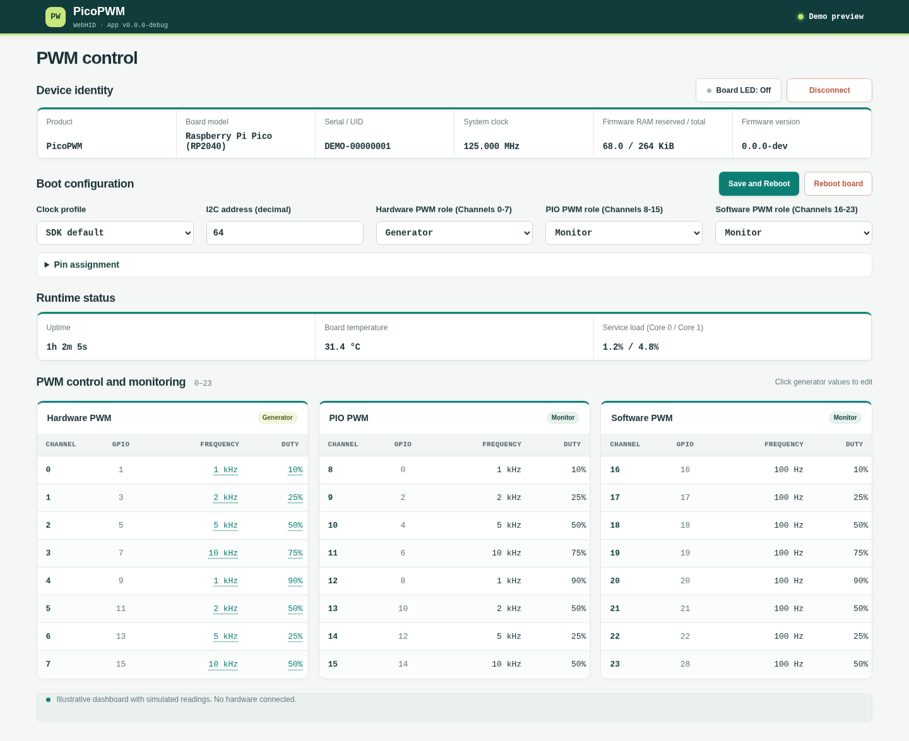

# PicoPWM

**24 PWM channels. One Pico. Three ways to control it.** PicoPWM turns a Raspberry Pi Pico or Pico 2 into a PWM
generator and frequency monitor, controlled through USB CDC, I2C or USB HID. The firmware exposes three fixed
8-channel banks. Configure each bank as a generator or monitor; channel IDs stay the same across control interfaces.

**Quick links:** [Download firmware](https://github.com/djwinter29-oss/PicoPWM/releases) ·
[Hardware setup](docs/guides/hardware-setup.md) ·
[Open browser dashboard](https://djwinter29-oss.github.io/PicoPWM/) ·
[Python package](https://pypi.org/project/picopwm-host/) ·
[Control interfaces](docs/guides/control/README.md)

## Why PicoPWM?

| | What you get |
| --- | --- |
| **24 channels, one stable map** | Three fixed 8-channel banks (A, B, C), configured independently as generators or monitors at startup. |
| **Choose the right PWM engine** | Hardware PWM, PIO and software backends, each with distinct frequency, accuracy and resource tradeoffs. |
| **Three control interfaces** | A USB CDC command shell, an I2C register map, and USB HID for dashboards and host applications. |
| **Live state, not just commands** | Read the realized channel frequency and duty as well as device configuration and status. |
| **Configuration survives reboot** | Save bank roles, I2C address and system clock to flash; changes take effect after reboot. |

_Current WebHID layout with simulated readings; illustrative, not a live hardware result._

| Backend | Characteristics | Constraints |
| --- | --- | --- |
| Hardware PWM | High timing accuracy | Pin/slice assignment and minimum-frequency limits |
| PIO PWM | Flexible placement and broad range | Finite state machines and divider/period quantization |
| Software PWM | Any ordinary GPIO | CPU and timer overhead limit channel count, frequency and accuracy |
| Monitor backends | Measure input signals | Backend-specific range and accuracy; software monitoring suits simple low-frequency signals |

## Before You Connect

- GPIO signals are **3.3 V only**; do not connect 5 V signals.
- I2C needs external pull-ups on SDA and SCL. Start at 100 kHz.
- The default configuration is monitor-only, so no PWM output is driven after power-up. Generator banks start at
  0 Hz and 0% duty; `stop` drives generator outputs low and leaves monitor banks unchanged.
- Bank roles are set in the startup configuration, not at build time. Change the target with `config set` (CDC), the
  matching I2C registers or HID, save it with `config save`, then reboot to apply it.
- The default system clock is the SDK default: 125 MHz on RP2040 and 150 MHz on RP2350. 150, 200 and 250 MHz profiles
  are optional overclocks and are not qualified for every board.
- Firmware has not been qualified on a hardware fixture; host tests do not replace hardware validation.

## Get Started

1. **Get the firmware.** Download the `pico` UF2 for Raspberry Pi Pico (RP2040) or `pico2` for Raspberry Pi Pico 2
   (RP2350) from [Releases](https://github.com/djwinter29-oss/PicoPWM/releases), or build it with
   `tools/firmware/build.sh --board pico` (or `pico2`). The UF2 is written to `build/<board>/pico_pwm.uf2`.
2. **Flash over USB.** Hold **BOOTSEL** while connecting the board, copy the `.uf2` to the `RPI-RP2` drive, and let it
   reboot. `tools/firmware/load.sh --board pico` (or `pico2`) automates this when the drive is mounted.
3. **Wire your signals.** Follow the [hardware setup guide](docs/guides/hardware-setup.md) for the channel GPIO map,
   I2C pins and board-specific pin considerations.
4. **Connect to PicoPWM.** Use the USB CDC shell at 115200 baud, or connect an I2C controller to the default 7-bit
   address `0x40`.
5. **Open a dashboard (optional).** Use the [browser dashboard](https://djwinter29-oss.github.io/PicoPWM/) or run one
   locally as described below.

## Dashboards

Use a dashboard for interactive control and monitoring. USB CDC and I2C remain available to scripts and other host
applications.

| Dashboard | How to run it |
| --- | --- |
| **Browser (WebHID)** | Open the [hosted dashboard](https://djwinter29-oss.github.io/PicoPWM/) in desktop Chrome or Edge; no backend required. See [host/webhid](host/webhid/README.md). |
| **Python** | Run `tools/host/run-python.sh`, then open `http://127.0.0.1:5000/`; see [host/python](host/python/README.md). |
| **.NET** | Run `tools/host/run-dotnet.sh`; see [host/dotnet](host/dotnet/README.md). |

The Python and .NET hosts talk to the board over USB HID.

## Documentation

| Need | Guide |
| --- | --- |
| Wire and configure the board | [Hardware setup](docs/guides/hardware-setup.md), [Firmware configuration](docs/guides/configuration.md) |
| Control it | [Control interfaces](docs/guides/control/README.md), [USB CDC CLI](docs/guides/control/usb_cdc_cli.md), [I2C protocol](docs/guides/control/i2c_protocol.md) |
| Understand the design | [Architecture](docs/design/architecture.md), [PWM driver design](docs/design/pwm_driver_design.md), [generators](docs/design/generator/) and [monitors](docs/design/monitor/) |
| Write a HID host | [CDC/HID overview](docs/design/usb/cdc-hid-overview.md), [HID report reference](docs/design/usb/hid-report-reference.md) |
| Build, test and release | [Build structure](BUILD_STRUCTURE.md), [Builds and publishing](docs/guides/releases.md) |
| Contribute | [Contributing](CONTRIBUTING.md), [Code of Conduct](CODE_OF_CONDUCT.md), [Security](SECURITY.md) |

The USB identity `0xCAFE:0x4012` is for development and lab use, not commercial derivatives. The CDC, HID and I2C
interfaces are unauthenticated; see [SECURITY.md](SECURITY.md). Build prerequisites, version handling and test commands
are in [BUILD_STRUCTURE.md](BUILD_STRUCTURE.md).

Related projects: [PicoUART](https://github.com/djwinter29-oss/PicoUart) (six USB serial ports) and
[PicoForge](https://github.com/djwinter29-oss/PicoForge) (host-controlled board services). They share no runtime
dependency. The CDC shell uses [embedded-cli](https://github.com/funbiscuit/embedded-cli), included as the
`firmware/third_party/embedded-cli` submodule (v0.1.4, MIT).

## License

[BSD 3-Clause](LICENSE).
