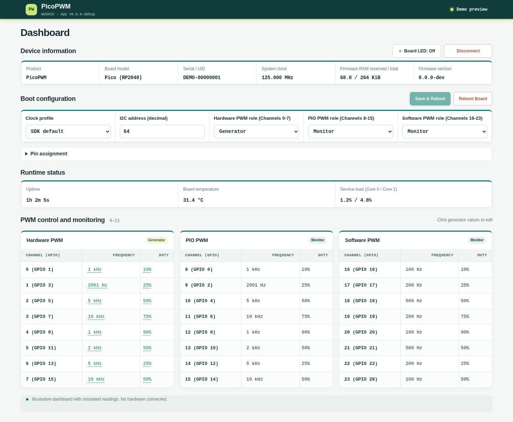

# PicoPWM

PicoPWM turns a Raspberry Pi Pico or Pico 2 into a 24-channel PWM generator and monitor.
Control it through USB CDC, USB HID, or I2C. Three fixed 8-channel banks use
hardware PWM (A), PIO (B), and software PWM (C); each bank generates or monitors.
Channel IDs are the same across interfaces.

_Simulated readings, not live hardware. Python and .NET share this layout._

## Get Started

1. Download the `pico` or `pico2` UF2 from [Releases](https://github.com/djwinter29-oss/PicoPWM/releases).
   Hold **BOOTSEL** while connecting a **USB data cable**, then copy the UF2 to the boot drive.
2. Check [board compatibility and wiring](docs/guides/hardware-setup.md) before connecting signals.
3. Choose a control option below and check the running bank roles before driving outputs.

**GPIOs are 3.3 V only. Never connect generator outputs together.** Banks default to monitor-only;
generator banks start at 0 Hz / 0% duty. Start with the default system clock.

| Control option | Start here |
| --- | --- |
| Browser | [Open Direct Dashboard](https://djwinter29-oss.github.io/PicoPWM/) in desktop Chrome or Edge; no installation. [Connection guide](host/direct/README.md). |
| Python | [Install `picopwm` from PyPI](host/python/README.md#quick-start); Python 3.10+. |
| .NET | [Download a standalone dashboard](host/dotnet/README.md#standalone-application); no separate .NET runtime needed. |
| Serial CLI | [Try your first generator output](docs/guides/configuration.md#first-generator-output). [Command reference](docs/protocols/usb-cdc.md). |
| I2C | [Wire the controller](docs/guides/hardware-setup.md#i2c), then use the [register reference](docs/protocols/i2c.md). |

Connect the board to the computer running the browser or host application.
Linux may need [HID permissions setup](docs/guides/linux-hid-access.md).

## Documentation

- [Documentation index](docs/README.md) — guides, protocols, design, and validation.
- [Configuration and operating ranges](docs/guides/configuration.md) · [Dashboard controls](docs/guides/dashboard-controls.md) · [Troubleshooting](docs/guides/troubleshooting.md).
- [Contributing](CONTRIBUTING.md) — build, test, and development instructions.

Interfaces have no firmware-level authentication and are intended for trusted local access.
See [SECURITY.md](SECURITY.md) for the trust model and reporting.

## License

First-party code: [BSD 3-Clause](LICENSE), copyright (c) 2026 Ji Dong.
Third-party dependencies retain their own licenses.
