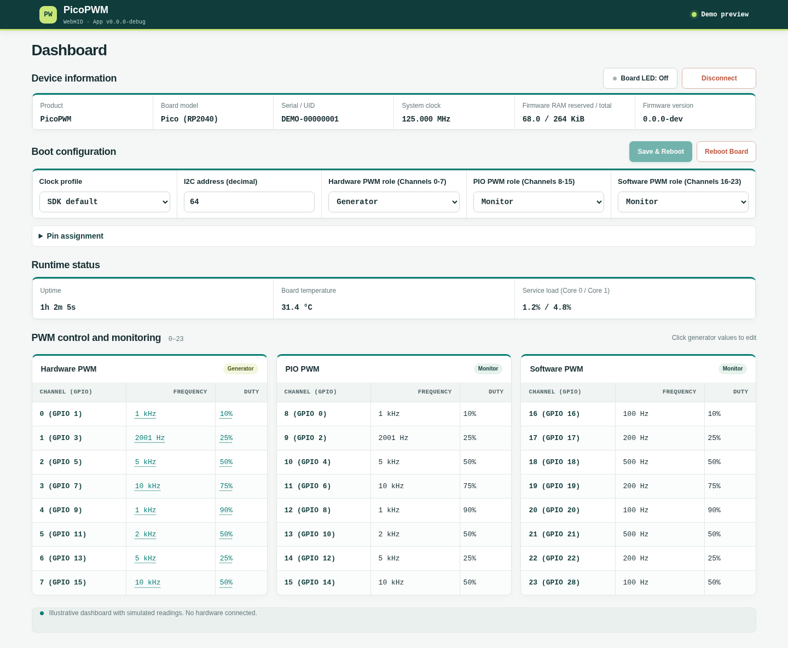

# PicoPWM

[](https://github.com/djwinter29-oss/PicoPWM/actions/workflows/pr-test.yml)
[](https://github.com/djwinter29-oss/PicoPWM/actions/workflows/release.yml)
[](LICENSE)


**24 PWM channels. One Pico. Three control interfaces.** PicoPWM turns a Raspberry Pi Pico or Pico 2 into a PWM
generator and frequency monitor. Control it through the USB CDC serial CLI, I2C, or USB HID; Direct Dashboard
uses the browser's WebHID API, while the Python and .NET host apps use USB HID. The firmware exposes three fixed 8-channel banks.
Bank A uses hardware PWM, Bank B uses PIO, and Bank C uses software PWM. Generator/monitor roles apply to an
entire bank; channel IDs stay the same across control interfaces.

**Quick links:** [Download firmware](https://github.com/djwinter29-oss/PicoPWM/releases) ·
[Hardware setup](docs/guides/hardware-setup.md) ·
[Open dashboard](https://djwinter29-oss.github.io/PicoPWM/) ·
[Python package](https://pypi.org/project/picopwm/) ·
[Standalone .NET downloads](https://github.com/djwinter29-oss/PicoPWM/releases/latest)

## Why PicoPWM?

- **Simple serial CLI:** control outputs and read channel state from a USB serial terminal.
- **Easy test automation:** integrate PWM generation and monitoring into test scripts using the CLI, Python HID
  client, or I2C. Start with the [Python scripting example](host/python/README.md#use-from-python).
- **Ready-to-use dashboards:** control and monitor channels through a browser, Python, or standalone .NET application.
- **24 channels in three banks:** each eight-channel bank is configurable as a generator or monitor, with a fixed
  hardware, PIO, or software PWM backend.



_Illustrative dashboard with simulated readings, not a live hardware result. Python and .NET share this layout._

## Get Started

**Supported boards:** Raspberry Pi Pico (`pico`, RP2040) and Pico 2 (`pico2`, RP2350).
Pico W and Pico 2 W are not supported; [third-party boards need compatibility checks](docs/guides/hardware-setup.md#board-compatibility).

Before wiring:

- GPIO signals are **3.3 V only**; never connect 5 V signals or tie generator outputs together.
- Banks default to **monitor-only**. Generator banks start at 0 Hz / 0% duty.
- Use the default system clock; higher profiles may overclock the board and are not qualified for every board.
- For I2C, add external SDA/SCL pull-ups and start at 100 kHz (default address `0x40`).

1. **Flash firmware.** Download your board's UF2 from [Releases](https://github.com/djwinter29-oss/PicoPWM/releases).
   Hold **BOOTSEL** while connecting the board with a **USB data cable**, then copy the UF2 to the boot drive.
2. **Choose a control interface.** Follow the [wiring guide](docs/guides/hardware-setup.md), then use either:
   - **Browser:** open [Direct Dashboard](#direct-dashboard) in desktop Chrome or Edge; no application
     installation is needed. Connect and check the firmware version and running bank roles.
   - **Serial CLI:** open the [USB CDC shell](docs/guides/usb-cdc-shell.md) in a serial terminal, then follow
     the example below.

### Serial CLI Example

Verify the firmware version and running configuration:

```text
board get version
config get
```

To try 1 kHz / 50% output, connect a 3.3 V-safe oscilloscope or logic analyzer to
**GPIO 1 (physical pin 2 on Pico/Pico 2) and GND**, then run:

```text
config set banka=generator
```

This saves the setting and reboots automatically. Reconnect, then run:

```text
pwm set 0 1000 50
pwm get 0
```

Illustrative readback (realized values can vary with timing quantization):

```text
CH0: freq=1000 Hz, duty=50%, enabled=yes
```

This is firmware readback, not an independent electrical measurement.
**When finished**, stop all generator outputs:

```text
pwm stop all
```

Stopping does not change saved bank roles; Bank A remains configured as a generator after reboot. To restore
monitor-only operation, see [Configure bank roles](docs/guides/setup-and-troubleshooting.md#configure-bank-roles).
For configuration and connection issues, see [Setup and troubleshooting](docs/guides/setup-and-troubleshooting.md).

## Dashboards

For browser and desktop dashboards, Linux may require
[HID permissions setup](docs/guides/setup-and-troubleshooting.md#linux-hid-access).

### Direct Dashboard

Open [Direct Dashboard](https://djwinter29-oss.github.io/PicoPWM/), click **Connect**, select your board, and grant
browser permission when prompted. No application installation is needed.

> [!IMPORTANT]
> **Direct Dashboard requires desktop Google Chrome or Microsoft Edge.** Safari and Firefox are not supported.
> Connect the board to the computer running the browser.

See the [Direct Dashboard guide](host/direct/README.md) for controls and connection troubleshooting.

### Desktop Dashboards

| Option | Start here |
| --- | --- |
| Python 3.10+ | [Install and run `picopwm`](host/python/README.md#quick-start) from PyPI. |
| Standalone .NET | [Download and run](host/dotnet/README.md#standalone-application) a release package for Linux x64, Windows x64, or macOS ARM64; no separate .NET installation needed. |

Connect the board to the computer running the host application.

## Recommended Frequency Ranges

Conservative starting points, **not hardware-qualified accuracy specifications**:

| Backend | Generation | Measurement |
| --- | --- | --- |
| [Hardware PWM](docs/design/pwm-driver/hardware.md) (Bank A) | 10 Hz-1 MHz | 100 Hz-1 MHz |
| [PIO PWM](docs/design/pwm-driver/pio.md) (Bank B) | 1 Hz-100 kHz | 10 Hz-100 kHz |
| [Software PWM](docs/design/pwm-driver/software.md) (Bank C) | 1 Hz-1 kHz | 10 Hz-1 kHz |

Generation accepts integer 0%-100% duty. At `0 Hz`, duties `0%-99%` drive static low and `100%` drives static high;
readback reports `0 Hz` with `0%` or `100%` respectively. Use moderate duty cycles for PWM;
narrow pulses and timing quantization reduce usable ranges.
**PIO duty readback can differ from the physical signal**, especially at high frequencies;
see the [timing caveats](docs/design/pwm-driver/pio.md#frequency-versus-duty-resolution).
Start PIO and software measurement at 10 Hz; below that, results are experimental rather than a verified accuracy
floor. See the [PIO monitor limitations](docs/design/pwm-driver/pio.md#monitor-design) and the
[reported low-frequency PIO-to-software loopback observation](docs/design/pwm-driver/software.md#low-frequency-loopback-observation).
Backend links above cover extended ranges and limitations.

Operator-reported Pico loopback checks covered all three generator banks at 100, 500, and 1000 Hz with 25%, 50%,
and 75% duty; see the [test record and its limitations](docs/tests/records/30-10-2026-manual-pico-bank-rotation.md).
These functional checks are not independent accuracy qualification; verify electrical output with an independent
instrument.

## Documentation

See the [documentation index](docs/README.md) for the full map.

| Need | Resource |
| --- | --- |
| Wire, configure, and troubleshoot | [Hardware setup](docs/guides/hardware-setup.md), [Setup and troubleshooting](docs/guides/setup-and-troubleshooting.md) |
| Control it | [USB CDC shell](docs/guides/usb-cdc-shell.md), [I2C protocol](docs/design/i2c/i2c-protocol.md), [USB interface overview](docs/design/usb/usb-interface-overview.md) |
| Understand the design | [Architecture](docs/design/architecture.md), [PWM driver design](docs/design/pwm-driver/driver-design.md) |
| Write a HID host | [HID report reference](docs/design/usb/hid-report-reference.md) |
| Build, test and release | [Builds and publishing](docs/deployment/releases.md) |
| Contribute | [Contributing](CONTRIBUTING.md), [Code of Conduct](CODE_OF_CONDUCT.md), [Security](SECURITY.md) |

PicoPWM uses USB VID `0x2E8A` and PID `0x116C`, allocated by Raspberry Pi through its
[USB PID program](https://github.com/raspberrypi/usb-pid).
The USB manufacturer string is `djwinter` and the product string is `PicoPWM`; CDC and HID remain
separate interfaces of the same composite device.

The CDC, HID, and I2C interfaces are intended for trusted local access and have no firmware-level authentication.
See [SECURITY.md](SECURITY.md) for the trust model and vulnerability reporting.

Related projects: [PicoUART](https://github.com/djwinter29-oss/PicoUart) (six USB serial ports) and
[PicoForge](https://github.com/djwinter29-oss/PicoForge) (host-controlled board services). They share no runtime
dependency.

Third-party software: the CDC shell uses [embedded-cli](https://github.com/funbiscuit/embedded-cli), included as the
`firmware/third_party/embedded-cli` submodule (v0.1.4, MIT).

## License

First-party code: [BSD 3-Clause](LICENSE), copyright (c) 2026 Ji Dong.
Third-party dependencies retain their own licenses.
