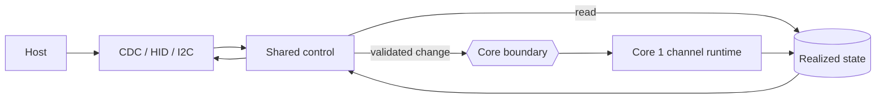

# Firmware Architecture

PicoPWM separates host communication from real-time channel work. This page
describes the main ownership boundaries; the linked design pages cover the
decisions within each subsystem.

## Core Ownership

| Core | Responsibility |
| --- | --- |
| Core 0 | USB CDC, USB HID, I2C, command handling, and host-facing responses |
| Core 1 | PWM generation and monitoring, backend state, and timing-related interrupts |

The cores exchange validated channel commands and a snapshot of realized
channel state. Host transports do not call PWM backends directly.

## Channel Model

PicoPWM exposes one logical channel model over three fixed backend banks.
Startup configuration selects whether each bank generates or monitors PWM.
Channel identity is consistent across CDC, HID, and I2C; physical pin
assignments are documented in [Hardware Setup](../guides/hardware-setup.md).

## Request Path

Reads return the latest published state. A change request crosses the core
boundary and is applied by the selected backend before its result is returned.

## Host Transports

Each interface's host-visible behavior is defined only in its
[protocol reference](../README.md#wire-protocols); this section covers
how the firmware is layered behind it.

All transports follow the same split: USB callbacks and the I2C interrupt only
capture bytes, and commands execute later in the Core 0 main loop. While Core 0
waits for a PWM apply, it keeps the USB stack moving but does not execute
another command, which would re-enter the shared control path.

| Transport | Capture | Execution | Bound |
| --- | --- | --- | --- |
| CDC | USB stack queues line input per session | Shell parses and runs one line at a time | Input/output queues; one command in progress |
| HID | SET_REPORT copies the request into one slot | Main loop executes the slot and publishes its result | One request slot |
| I2C | Interrupt captures write frames and streams read responses | Main loop drains queued valid writes | Fixed command queue |

Layer rules:

- **Transport** code (USB glue, I2C peripheral port) moves bytes and tracks
  session or transaction boundaries; it does not interpret commands.
- **Protocol** code (shell command groups, HID report codec, I2C register map)
  validates complete input, calls shared control, and reports the result it
  returns rather than assuming success.
- I2C interrupt work stays bounded: no blocking, no backend calls, and only
  short synchronization when a read needs a consistent channel snapshot.
- A CDC disconnect resets the session but does not cancel work already
  started. Each output write is all-or-nothing, but a multi-write response can
  still stop partway.
- Add CDC commands to an existing command group unless they control a distinct
  device area.

## Startup and Runtime

Core 0 loads the running configuration and starts Core 1. Core 1 initializes
the selected backends and signals readiness before host transports accept
channel operations. After startup, Core 0 handles requests while Core 1
services channel work independently.

## Related Design

- [PWM driver](pwm/driver.md) — core boundary, command handling, and readback
- [PWM banks](pwm/banks.md) — fixed banks and startup roles
