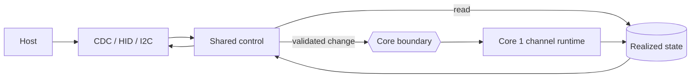

# Firmware Architecture

Core 0 handles host communication. Core 1 owns PWM backends and timing.

## Core Ownership

| Core | Responsibility |
| --- | --- |
| Core 0 | USB CDC, USB HID, I2C, command handling, and host-facing responses |
| Core 1 | PWM generation and monitoring, backend state, and timing-related interrupts |

The cores exchange validated channel commands and a snapshot of realized
channel state. Host transports do not call PWM backends directly.

## Channel Model

Three fixed banks share one logical channel model across CDC, HID, and I2C.
Startup configuration selects generator or monitor for each bank.
See the [GPIO map](../guides/hardware-setup.md#pwm-channels).

## Request Path

Reads return the latest published state. A change request crosses the core
boundary and is applied by the selected backend before its result is returned.

## Host Transports

Wire contracts: [CDC](../protocols/usb-cdc.md),
[HID](../protocols/usb-hid.md), [I2C](../protocols/i2c.md).

USB callbacks and the I2C interrupt capture bytes; the Core 0 main loop
executes commands. While waiting for a PWM apply, Core 0 services USB but
does not execute another command or re-enter shared control.

| Transport | Capture | Execution | Bound |
| --- | --- | --- | --- |
| CDC | USB stack queues line input per session | Shell parses and runs one line at a time | Input/output queues; one command in progress |
| HID | SET_REPORT copies the request into one slot | Main loop executes the slot and publishes its result | One request slot |
| I2C | Interrupt captures write frames and streams read responses | Main loop drains queued valid writes | Fixed command queue |

- **Transport** code moves bytes and tracks sessions/transactions; it does
  not interpret commands.
- **Protocol** code validates complete input, calls shared control, and
  reports the actual result.
- I2C interrupts must not block or call backends. Snapshot reads use only
  short synchronization.
- A CDC disconnect resets the session but does not cancel work already
  started. Each output write is all-or-nothing, but a multi-write response can
  still stop partway.
- Add CDC commands to an existing command group unless they control a distinct
  device area.

## Startup and Runtime

Core 0 loads configuration and starts Core 1. Core 1 initializes backends
and signals readiness before transports accept channel operations.
The cores then service requests and channel work independently.

See [PWM design](pwm.md) for bank ownership, backend behavior, and readback.

## Implementation Map

| Responsibility | Source |
| --- | --- |
| Shared host-facing channel control | [`control_api.c`](../../firmware/src/control_api.c) |
| Core boundary and realized-state snapshot | [`pwm_driver.c`](../../firmware/src/driver/pwm/pwm_driver.c), [`pwm_driver.h`](../../firmware/src/driver/pwm/pwm_driver.h) |
| CDC command handling | [`cli_channel_commands.c`](../../firmware/src/app/cli/cli_channel_commands.c) |
| USB HID reports | [`hid_protocol.c`](../../firmware/src/app/usb/hid_protocol.c) |
| I2C register map | [`i2c_control_map.c`](../../firmware/src/app/i2c/i2c_control_map.c) |
| Backend implementations | [`driver/pwm/`](../../firmware/src/driver/pwm/) |
