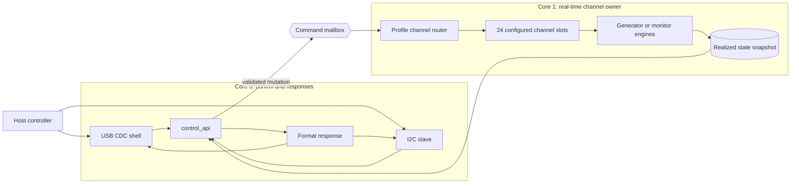
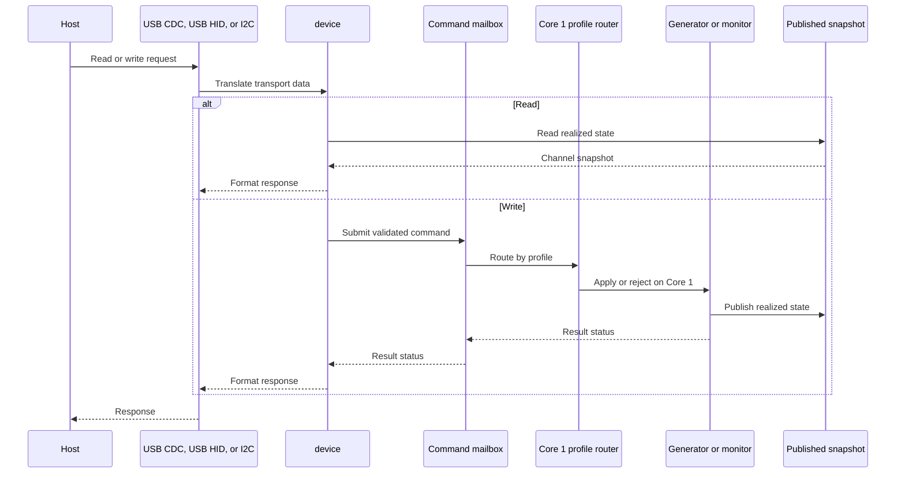
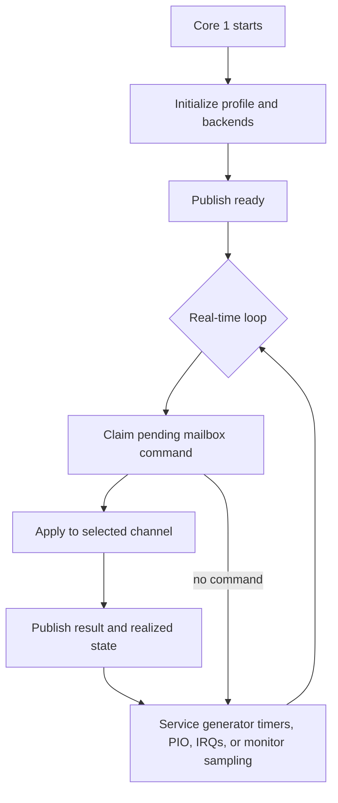
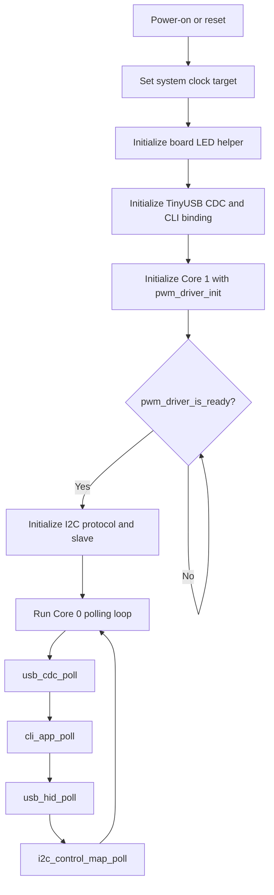

# Architecture

This page describes the current PicoPWM runtime structure. It focuses on module ownership and request flow, not backend implementation detail.

For mailbox state machines and publication internals, see [PWM Driver Design](pwm-driver/driver-design.md). Backend-specific behavior is covered in the hardware, PIO, and software design pages below.

## At A Glance

The firmware has two deliberately different responsibilities:

- **Core 0** owns host-facing control requests and responses for USB CDC, USB HID, and I2C.
- **Core 1** owns real-time work for every configured channel, whether that
  channel is a PWM generator or a PWM monitor.

The cores communicate through a small command mailbox and a published state
snapshot. Host transports never call generator or monitor backends directly.

Reads use the snapshot directly. Writes enter the mailbox, are applied by
Core 1, and return a result after the selected channel backend accepts or
rejects the request.

## Architecture Documents

Use the architecture-related pages as follows:

- [Architecture](architecture.md) — system structure, layer boundaries, and request flow
- [USB CDC CLI Design](usb/cdc-cli-design.md) — CLI responsibilities, session rules, and command extension workflow
- [Setup and Troubleshooting](../guides/setup-and-troubleshooting.md) — operating configuration and common problems
- [Hardware Setup](../guides/hardware-setup.md) — physical PWM, I2C, and shared-pin mapping
- [PWM Driver Configuration](pwm-driver/configuration.md) — fixed channel allocation and capabilities
- [PWM Driver Design](pwm-driver/driver-design.md) — shared PWM ownership, mailbox, and state publication
- [USB Interface Overview](usb/usb-interface-overview.md) — USB interface roles and HID rules
- [HID Report Reference](usb/hid-report-reference.md) — HID report layouts and action semantics
- [Hardware PWM](pwm-driver/hardware.md) — hardware generator and monitor design
- [PIO PWM](pwm-driver/pio.md) — PIO generator and monitor design
- [Software PWM](pwm-driver/software.md) — software generator and monitor design

## System Model

PicoPWM targets Raspberry Pi Pico (RP2040) and Pico 2 (RP2350) with one shared
logical channel model. Startup bank configuration selects whether the fixed hardware,
PIO, and software banks act as PWM generators or PWM monitors.

The host-visible channel IDs and command syntax remain stable across profiles.
The PWM driver configuration, not the CLI, defines each channel's backend, direction,
GPIO, limits, and supported operations. The current default profiles expose 24
channels through this table.

Each logical channel exposes the same readback model:

- `freq_hz`
- `duty`

### Monitor Measurement Strategy

The monitor design is intentionally optimized for occasional latest-value
measurements, not waveform history or trend analysis. A host read needs one
usable frequency/duty result at a time; configuration changes and measured
signal changes are not expected to arrive at a rate that requires continuous
capture.

The three monitor banks therefore use different mechanisms according to their
hardware envelope:

- The hardware bank uses GPIO edge interrupts with software timestamps.
- The software bank uses one private Core 1 timer to sample all eight GPIOs,
    accumulating complete cycles over at least 20 ms. Work is independent of
    input edge rate, but narrow pulses and out-of-range signals can alias.
- The PIO bank captures one complete high/low period in PIO, reads the two FIFO
    words directly, and stops the state machine.

Continuous PIO capture through DMA was considered, but rejected for this
product. DMA would reduce CPU involvement while continuously draining the
FIFO, but the firmware would still retain only one latest sample. It would add
DMA-channel allocation, buffer-coherence handling, transfer-lifetime behavior,
and recovery paths without providing history or a better user-visible result.

CPU GPIO polling was rejected because it spends CPU time waiting and becomes
less reliable as frequency increases. GPIO edge interrupts remain appropriate
for the software bank. The hardware bank measures with the PWM slice counters in
input mode (time-shared edge and high-time windows); because bank A is already
fixed to the slice-B pins, this does not complicate the fixed bank model.

PIO one-period capture is the resulting compromise: PIO provides accurate
high/low timing for a complete period, while direct FIFO reads keep resource
ownership and runtime behavior small. If the product later requires continuous
high-rate capture, trend analysis, or waveform history, DMA or a dedicated
buffered capture design should be reconsidered as a new requirement rather than
added preemptively.

The hardware PWM bank intentionally uses PWM slice channel B pins so the external pin order stays aligned with the monitoring-oriented wiring plan. See [Hardware Setup](../guides/hardware-setup.md) for the physical mapping.

## Runtime Layers

The current firmware is split into four practical layers. The important rule is
that transport code reaches PWM hardware only through `control_api` and
`pwm_driver`.

### 1. Transport Layer

Core 0 owns the host-facing transports:

- `app/usb/usb_cdc.*` for TinyUSB CDC byte transport
- USB HID is an additional Core 0 management transport; see
  [USB Interface Overview](usb/usb-interface-overview.md)
- `app/cli/cli_shell.*` for the embedded-cli-backed line editor and command dispatch
- `app/cli/cli_*_commands.*` for human-readable command groups
- `app/cli/cli_app.*` for CDC command-shell lifecycle and connection output
- `app/cli/cli_syntax.h` for shared command syntax
- `driver/i2c/i2c_slave.*` for generic I2C transaction framing and response-byte transport; `i2c_slave_hw.*` is its SDK-facing peripheral port
- `app/i2c/i2c_control_map.*` for register selection, frame validation, protocol status, response construction, and PWM command dispatch

USB CDC uses bounded 128-byte receive and 2048-byte transmit queues. When the
receive queue is full, firmware stops draining the USB FIFO until space becomes
available. A transmit write returns failure when the local queue cannot accept
the complete response. This fixed-resource policy prevents unbounded memory
growth; hosts should keep the connection open and retry commands whose response
could not be queued. On DTR disconnect, CDC RX/TX queues and TinyUSB FIFOs are
cleared; the application resets the shell before allowing transport I/O for the
next session.

### 2. Shared Control Layer

`control_api.*` is the transport-neutral Core 0 API used by USB CDC, USB HID, and I2C.

Responsibilities:

- expose device info and firmware version
- return realized channel state
- translate channel updates into the shared PWM command path
- avoid introducing a second shadow cache above `pwm`

### 3. Multicore Boundary Layer

`driver/pwm/pwm_driver.*` is the architectural boundary between Core 0 command ingress and Core 1 backend ownership.

Responsibilities:

- accept validated logical channel writes from Core 0
- serialize public writes before mailbox submission
- forward one admitted command across the multicore mailbox
- publish realized state snapshots for Core 0 readers

### 4. Configuration and Backend Layer

The PWM driver configuration resolves logical channels from the bank choice and
`board.c` and validates them. Core 1 then dispatches each configured channel to its selected
backend.

Core 1 owns the backend implementations:

- `driver/pwm/hardware/hardware_generator.*` and `driver/pwm/hardware/hardware_monitor.*`
- `driver/pwm/pio/pio_generator.*` and `driver/pwm/pio/pio_monitor.*`
- `driver/pwm/software/software_generator.*` and `driver/pwm/software/software_monitor.*`

These modules own hardware configuration, IRQ or timer paths, and backend-local state.

## Core Ownership

### Core 0

Core 0 owns:

- USB CDC polling
- CLI command parsing and formatting
- I2C transport framing
- I2C deferred command execution
- shared control/status translation
- top-level startup sequencing

### Core 1

Core 1 owns:

- backend initialization
- PWM hardware and PIO state
- software PWM timer callbacks
- PWM-related IRQ handling
- publication of realized channel state

Core 0 must not call backend driver APIs directly.

## Request Flow

USB CDC, USB HID, and I2C converge at the same Core 0 control facade. Reads are answered
from the published snapshot; mutations cross the mailbox boundary:

Transport-specific details:

- I2C reads can be served directly from the published snapshot or last command status.
- The generic I2C driver captures opaque frames and sends response bytes. The PWM protocol layer validates and queues commands from the ISR; foreground polling executes them through the shared `control_api` path used by USB CDC and HID. Read responses use bounded getters when a read starts; a short cross-core snapshot lock can briefly stretch SCL.
- USB commands are parsed by `shell` and the CLI command handlers before they reach `control_api`.
- I2C register and payload semantics are decoded by `i2c_control_map` before they reach `control_api`.

This keeps the ISR transport-focused and avoids running backend-affecting logic in interrupt context.

## Core 1 Real-Time Loop

Core 1 does not wait for host traffic to manage channels. It initializes the
selected profile, services the command mailbox, and continuously services the
configured generator or monitor backends.

The mailbox is for control mutations and command results, not for streaming
every PWM edge. High-rate timing and measurement stay local to Core 1; Core 0
sees coherent realized snapshots.

## Cross-Core Mutation Boundary

`control_api` is the only public Core 0 mutation facade.

- Core 0 transport code enters through `control_api`.
- `control_api` forwards writes into the internal `pwm` mailbox API.
- Core 1 applies the write to the selected backend.
- Core 1 publishes the realized state after successful apply.
- Core 0 waits for the result and reports `ok`, `busy`, `invalid`, `timeout`, `unavailable`, or `apply failed` to the caller.

The internal `pwm` mailbox API is not part of the transport-facing interface.

## Shared State Model

The single source of truth for channel state is the snapshot published by `pwm`.

That means:

- reads report realized backend state, not just the last requested values
- `control_api` does not keep a second cache
- USB CDC, USB HID, and I2C observe the same logical channel view

`stop` disables generator outputs by driving them low (`freq = 0 Hz`, `duty = 0%`).

## Channel Layout

Logical IDs are configuration-defined and stable for host software. The
current default profile exposes `0..23`; backend ownership and GPIO assignment
must be read from the selected profile rather than inferred from an ID range.
See [PWM Driver Configuration](pwm-driver/configuration.md) and
[Hardware Setup](../guides/hardware-setup.md).

## Startup Sequence

The startup order matters because Core 0 must not accept host commands before
Core 1 has initialized the PWM ownership boundary.

In ordered form:

1. Core 0 applies the saved system-clock profile, if any; otherwise the SDK default clock stays.
2. Core 0 initializes the board LED helper.
3. Core 0 initializes TinyUSB CDC and the CLI transport binding.
4. Core 0 initializes and launches Core 1 with `pwm_driver_init(roles)`.
5. Core 0 waits for `pwm_driver_is_ready()`.
6. Core 0 initializes the I2C protocol state and slave transport.
7. The main loop services `usb_cdc_poll()`, `cli_app_poll()`, `usb_hid_poll()`, and `i2c_control_map_poll()`.

When the USB CDC host opens the connection, the CLI prints help and a prompt.
If the bounded transmit queue cannot accept the output, Core 0 retries it while
the connection remains open. If CLI initialization fails, the host receives an
explicit error when the CDC connection is available.

## Where To Read Next

- [USB CDC Shell](../guides/usb-cdc-shell.md) for interactive text commands
- [USB CDC CLI Design](usb/cdc-cli-design.md) for developer guidance on extending the CLI
- [I2C Protocol Reference](i2c/i2c-protocol.md) for binary register values
- Source headers under `firmware/src` for current C declarations and APIs
- [PWM Driver Design](pwm-driver/driver-design.md) for backend and mailbox internals
