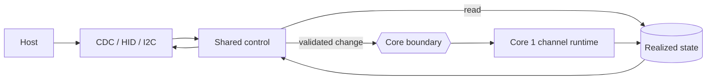

# Firmware Architecture

PicoPWM separates host communication from real-time channel work. This page
describes the main ownership boundaries; the linked design pages cover the
decisions within each subsystem.

## Core Ownership

| Core | Responsibility |
| --- | --- |
| Core 0 | USB CDC, USB HID, I2C, command handling, and host-facing responses |
| Core 1 | PWM generation and monitoring, backend state, and timing-related interrupts |

The cores exchange validated channel commands and a snapshot of realized
channel state. Host transports do not call PWM backends directly.

## Channel Model

PicoPWM exposes one logical channel model over three fixed backend banks.
Startup configuration selects whether each bank generates or monitors PWM.
Channel identity is consistent across CDC, HID, and I2C; physical pin
assignments are documented in [Hardware Setup](../guides/hardware-setup.md).

## Request Path

Reads return the latest published state. A change request crosses the core
boundary and is applied by the selected backend before its result is returned.
I2C defers channel changes out of interrupt context before using this path; the
[I2C driver design](i2c.md) describes that boundary.

## Startup and Runtime

Core 0 loads the running configuration and starts Core 1. Core 1 initializes
the selected backends and signals readiness before host transports accept
channel operations. After startup, Core 0 handles requests while Core 1
services channel work independently.

For channel ownership and state-publication rules, see the
[PWM driver design](pwm/driver.md).

## Related Design

- [PWM driver](pwm/driver.md) — core boundary, command handling, and readback
- [PWM banks](pwm/banks.md) — fixed banks and startup roles
- [CDC shell](usb-cdc.md) — command and session boundaries
- [I2C slave](i2c.md) — bus transport and deferred commands
