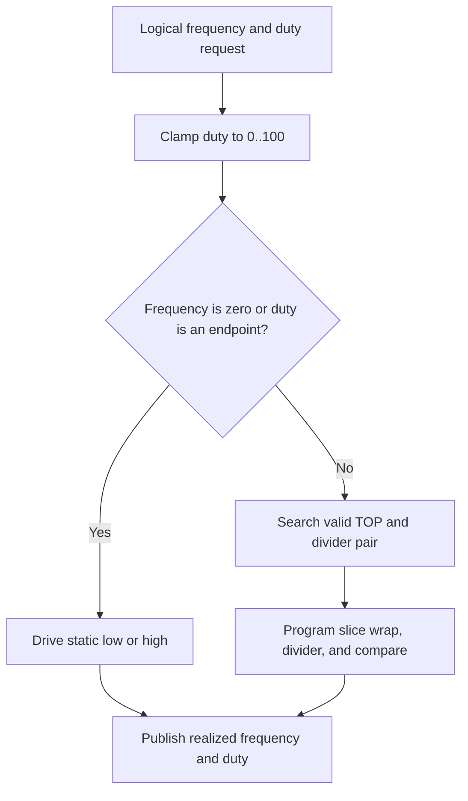

# Hardware PWM Design

This document describes the hardware PWM generator and monitor that share the
hardware PWM bank.

## Source Layout

| File | Responsibility |
| ------ | ---------------- |
| `firmware/src/driver/pwm/hardware/hardware_generator.c` | Hardware PWM generator backend implementation |
| `firmware/src/driver/pwm/hardware/hardware_generator.h` | Hardware PWM generator backend interface |

## Channel Model

The hardware PWM bank uses logical channels `0..7` in the unified driver model.
The physical GPIO and slice mapping is documented in [Hardware Setup](../../guides/hardware-setup.md).
The design intentionally uses slice-B pins so the physical channel order stays
aligned with the measurement-oriented wiring plan.

### Resource and Pin Constraints

The hardware backend is constrained by the MCU PWM peripheral:

- one backend channel requires a valid PWM-capable GPIO and slice/channel
    assignment
- the default profile is fixed to eight slice-B GPIOs: GPIO `1, 3, 5, 7, 9, 11,
    13, 15`; this is one fixed pin set, not a free choice among compatible
    slice/channel pins
- the hardware channel count is fixed at 8 (one per RP2040 PWM slice) and is
    not expandable by selecting a different GPIO
- the backend has a nonzero minimum frequency derived from its maximum divider
    and 16-bit period counter

These are profile constraints, not assumptions the host CLI should infer from
the logical channel number.

## Generator Design

### Intent

The hardware generator backend is the highest-accuracy PWM generator in the current firmware.

The public logical state uses:

- `freq_hz` as `uint32_t`
- `duty` as integer percent `0..100`

The generator treats `freq_hz = 0` as a static-output policy case:

- `freq_hz = 0`, `duty = 100` means static high
- `freq_hz = 0`, any other duty means static low

Nonzero-frequency endpoint duties also resolve directly to static levels:

- `duty = 0` means static low
- `duty = 100` means static high

### Generator Decision Flow

### Timing Model

The hardware PWM block uses:

- a 16-bit wrap counter, so `TOP + 1` can range from `2` to `65536`
- a fractional clock divider from `1.0` to `255 + 15/16`
- one independent PWM slice per logical channel

The realized PWM frequency is:

$$
f_{pwm} = \frac{f_{sys}}{clkdiv \cdot (TOP + 1)}
$$

In the current implementation the divider is searched in sixteenth-step units:

$$
clkdiv = \frac{div\_x16}{16}
$$

The practical low-end limit comes from the combination of the largest divider and the 16-bit counter:

$$
f_{min} = \left\lceil \frac{f_{sys} \cdot 16}{4095 \cdot 65536} \right\rceil
$$

The theoretical high-end limit comes from the smallest divider and the minimum valid period count of `2`:

$$
f_{max} = \frac{f_{sys}}{2}
$$

### Current Clock Plan and Supported Envelope

The firmware keeps the SDK default `clk_sys` (`125 MHz` on Pico, `150 MHz` on Pico 2) unless a saved profile raises it; a rejected profile also leaves the SDK default running.

Some board-level helper paths in this repository also show a `200 MHz` clock plan, so it is useful to show that case as a reference point too.

That gives the following hardware-generator envelope:

| `clk_sys` | Counter-limited minimum | Counter-limited maximum |
|-----------|-------------------------|-------------------------|
| `200 MHz` | about `12 Hz` | `100 MHz` |
| `150 MHz` | about `9 Hz` | `75 MHz` |
| `125 MHz` | about `8 Hz` | `62.5 MHz` |
| `250 MHz` | about `15 Hz` | `125 MHz` |

These are hardware representability limits, not the recommended operating range.
The maximum is a two-count waveform at divider 1, with only 0%, 50%, or 100%
compare levels. Firmware accepts generator requests only up to **10 MHz**.
There is no hardware-qualified absolute electrical maximum for this project:
pin loading, wiring, system clock, and signal integrity must be checked separately.

### Target Working Range

The recommended working range for the hardware PWM generator is:

- about `10 Hz .. 1 MHz`

That target range is narrower than the raw hardware envelope for two reasons:

1. The low end should stay above the worst-case counter-and-divider floor even when the startup clock falls back from `150 MHz` to `125 MHz`.
2. The high end should keep enough counter counts per period to preserve useful duty-cycle resolution.

At the top of the recommended range, with `clkdiv = 1`:

- `1 MHz` gives about `200` counts per period at `200 MHz`
- `1 MHz` gives about `150` counts per period at `150 MHz` and about `125` counts per period at `125 MHz`
- that corresponds to duty steps of about `0.5%`, `0.67%`, or `0.8%`, which is still practical

Above that range the backend can still generate outputs, but duty granularity degrades quickly because the 16-bit counter is no longer the limiting factor; the number of available counts per period collapses as frequency rises.

### Frequency Versus Duty Resolution

The following values come from the current timing search, not an assumption
that divider 1 is always selected. `N = TOP + 1`; one compare-count increment
changes duty by `100/N` percentage points. Default clocks are shown, not overclock profiles.

| Requested frequency | Selected N at 125 MHz (Pico) | Duty step (percentage points) | Selected N at 150 MHz (Pico 2) | Duty step (percentage points) |
| --- | ---: | ---: | ---: | ---: |
| 1 kHz | 64516 | 0.00155 | 64865 | 0.00154 |
| 10 kHz | 12500 | 0.008 | 15000 | 0.00667 |
| 100 kHz | 1250 | 0.08 | 1500 | 0.0667 |
| 1 MHz | 125 | 0.8 | 150 | 0.667 |
| 2 MHz | 50 | 2 | 75 | 1.333 |
| 5 MHz | 25 | 4 | 30 | 3.333 |
| 10 MHz | 10 | 10 | 15 | 6.667 |

These example requests have exact rounded frequency readback at both clocks;
arbitrary frequencies need not. Duty requests and readback use integer percent,
so sub-1-percentage-point counter resolution does not provide sub-1% API control.
For example, 50% at 10 MHz becomes 50% at 125 MHz (5/10 counts), but about
53.3% at 150 MHz (8/15 counts; readback rounds to 53%). Resolution is not a
measured accuracy guarantee.

The public generator request ceiling is **10 MHz**. Above 1 MHz is experimental,
not part of the recommended precision range. Frequency and duty are quantized;
the timing search prioritizes frequency error and may choose fewer counter
counts than the divider-1 examples above. At 125 MHz, for example, the search
selects an exact 10 MHz model with a ten-count period and divider 1.25, giving
10 percentage-point duty steps. Do not assume the maximum possible counter
resolution will be selected. Non-endpoint duty requests can quantize to static
levels, and fractional dividers can introduce cycle-to-cycle variation.

Readback reports the programmed timing model, not an electrical measurement.
Verify frequency, duty, and signal integrity with an oscilloscope before using
MHz-range output. This change does not extend monitor ranges. The current hardware
monitor uses PWM input counters, not per-edge CPU interrupts; its limits are described below.

### Generator Workflow

The current generator workflow is:

1. accept one logical request in integer `freq_hz` and integer duty percent
2. clamp duty into `0..100`
3. resolve static outputs first for `freq_hz = 0` and endpoint duties
4. otherwise search every legal divider, from the smallest wrap-legal value through the maximum, for the closest valid `TOP` and divider pair, and stop on an exact match
5. program wrap, divider, and compare level into the slice
6. publish the realized frequency and the realized duty (`level` over `TOP + 1`, rounded) through the backend state

The timing search (`pwm_hw_find_timing` in `hardware_math.h`) is pure integer math taking the system clock as a
parameter, and a host sweep test bounds its error. It rejects zero, frequencies below the minimum for the clock, and
frequencies above half the system clock, so the backend has no separate range check. The config layer's fixed `10 Hz`
floor is the documented public limit; at higher system clocks the real minimum rises (about `15 Hz` at `250 MHz`) and
the backend then rejects the request with an apply failure.

### Generator Tradeoffs

The generator path intentionally prefers:

- integer-only timing search
- realized-state publication in C
- static GPIO drive for `freq_hz = 0`

over:

- float math in the timing path
- squeezing every representable MHz into the recommended user range

## Monitor Design

The hardware monitor uses the PWM slice counters in input mode. Bank A is
fixed to slice-B GPIOs, which support this input mode. Because each slice has
one counter, measurement alternates between an edge-count window for frequency
and a high-time window for duty.

| Window | Slice mode | Measurement |
| --- | --- | --- |
| Edge | Rising-edge count | A 250 ms window counts edges; frequency is edges divided by the window duration. |
| High | High-time count | A 250 ms window measures high time; duty is high time divided by the window duration. |

Core 1 accumulates counter wraps while servicing the monitor. The two
measurement windows take about 500 ms in total, so a sample is not available
until the first pair completes and refresh is relatively slow. Frequency
resolution is about 4 Hz; this backend is most reliable above roughly 20 Hz.
Use the software monitor for slower signals.

If no edge is counted, the monitor reports `0 Hz` and uses the sampled GPIO
level to report duty as `0%` or `100%`. Duty assumes that the signal is stable
across both measurement windows; a signal change between windows can produce a
mixed sample.

This design has not been validated on physical hardware.

### Monitor Frequency and Duty Limits

The generator's maximum does not specify the monitor's maximum. There is no
qualified absolute monitor frequency ceiling. Input synchronization, pulse
width, and timely wrap polling all constrain measurements.

| Input frequency | Edges in a nominal 250 ms window | One-count frequency resolution | Interpretation |
| --- | ---: | ---: | --- |
| 20 Hz | 5 | 4 Hz (20% of input) | Low-end frequency measurement is coarse |
| 100 Hz | 25 | 4 Hz (4%) | More useful frequency resolution |
| 1 kHz | 250 | 4 Hz (0.4%) | Duty is measured in a separate window |
| 100 kHz | 25000 | 4 Hz (0.004%) | Requires valid pulse widths and wrap servicing |
| 1 MHz | 250000 | 4 Hz (0.0004%) | Multiple wraps; not a hardware accuracy claim |
| 10 MHz | 2500000 | 4 Hz (0.00004%) | Experimental; not qualified by generator support |

Duty counter resolution is nominally
`100 * HW_MON_HIGH_DIV / (clk_sys * window_seconds)` percentage points,
not the generator's `100/N`. At 125 MHz and a 250 ms window this is about
0.0000128 percentage points, but integer-percent output, window timing, input
synchronization, and missed wraps dominate practical accuracy. Frequency and
duty windows are not simultaneous. The single wrap flag cannot count multiple
wraps between polls; long Core 1 stalls can corrupt either measurement.
