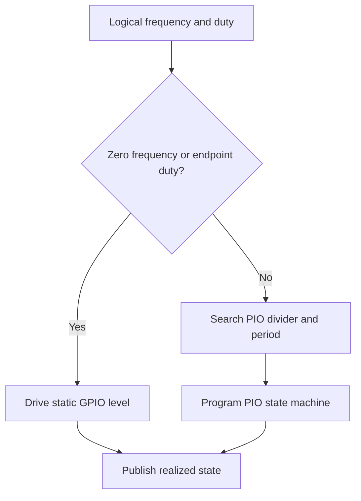
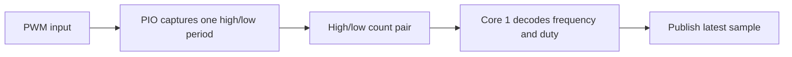

# PIO PWM Design

The PIO generator produces continuous PWM output using one PIO state machine
per configured channel. Source files:

- `firmware/src/driver/pwm/pio/pio_generator.c`
- `firmware/src/driver/pwm/pio/pio_generator.h`
- `firmware/src/driver/pwm/pio/pio_generator.pio`

## Resource Constraints

The PIO generator is capped at 8 channels total: two PIO blocks, four state
machines each. The default profile fixes these 8 channels to the 8 companion
slice-A GPIOs paired with the hardware PWM slices (`0, 2, 4, 6, 8, 10, 12,
14`); this is one fixed pin set, not a free choice among routable GPIOs. A
custom profile must still ensure that each channel has a valid PIO state
machine and routable GPIO. Generator and monitor channels must not claim the
same PIO resource.

The PIO timing divider and period counter quantize the realized frequency, so
the applied frequency may differ from the requested frequency. The profile's
generator request range is `1 Hz .. 10 MHz`. Above 1 MHz is experimental,
with coarse duty resolution; this does not extend any monitor's supported range.

### High-Frequency Generation

The 10 MHz ceiling is a request limit, not a precision or hardware-qualification
guarantee. The timing search selects a realizable period and fractional divider;
the realized frequency can differ from the request and individual periods can
vary with fractional-divider timing.

The loop takes `3N + 2` PIO clock cycles per period for `N` countdown iterations.
At 125 MHz, 10 MHz output leaves only a few iterations per period, so duty steps
can be tens of percentage points. At 150 MHz or higher clocks, the available
resolution differs. Requested 1% increments are not achievable at these rates;
non-endpoint duty requests can quantize to no high pulse. Fixed instruction
overhead also matters increasingly at short periods. Endpoint requests of 0%
and 100% still select static outputs.

Use an oscilloscope to verify actual frequency, high/low widths, and signal
integrity before using MHz-range output. Readback is a programmed timing model,
not an independent electrical measurement. Use a lower frequency if fine duty
control is required. The hardware monitor uses PWM input counters with its own
measurement limits; sampled software monitoring aliases outside its intended range.

### Timing Maximum Versus Firmware Ceiling

With divider 1 the current generator's timing helper permits a minimum of
`N = 2` iterations, or eight PIO clocks per period. Its representable maximum
is therefore `clk_sys / 8`, not the PIO peripheral's fastest possible pin toggle
with a different program.

| System clock | Current-loop timing maximum | Firmware request ceiling |
| --- | ---: | ---: |
| 125 MHz (Pico default) | 15.625 MHz | 10 MHz |
| 150 MHz (Pico 2 default) | 18.75 MHz | 10 MHz |
| 200 MHz profile | 25 MHz | 10 MHz |
| 250 MHz profile | 31.25 MHz | 10 MHz |

Clock profiles are not all qualified for every board. These are digital timing
limits, not verified electrical maxima or a promise of useful duty control.

### Frequency Versus Duty Resolution

These are selections from the current timing helper. The duty model uses
`H/N`, with `H = round(N * requested_duty / 100)`. The model's duty step is
`100/N` percentage points; both the public request and readback remain integer percent.

| Requested frequency | Selected N at 125 MHz | Model duty step (percentage points) | Selected N at 150 MHz | Model duty step (percentage points) |
| --- | ---: | ---: | ---: | ---: |
| 1 kHz | 41667 | 0.0024 | 50000 | 0.002 |
| 10 kHz | 4166 | 0.024 | 5000 | 0.02 |
| 100 kHz | 416 | 0.240 | 499 | 0.200 |
| 1 MHz | 41 | 2.439 | 48 | 2.083 |
| 2 MHz | 20 | 5 | 23 | 4.348 |
| 5 MHz | 6 | 16.667 | 9 | 11.111 |
| 10 MHz | 2 | 50 | 3 | 33.333 |

**Important current readback limitation:** `H/N` ignores the instruction
positions of the side-set transitions. For a nonzero high pulse, the actual
instruction-level high fraction is `(3H - 1) / (3N + 2)`, not `H/N`.
Each high-iteration step changes that fraction by `300/(3N + 2)` percentage
points. At short periods the difference is substantial:

| Request at 50% duty | Clock | Rounded frequency model | Integer duty readback | Instruction-level high fraction |
| --- | ---: | ---: | ---: | ---: |
| 1 MHz | 125 MHz | 1000000 Hz | 51% (21/41) | 49.6% |
| 5 MHz | 125 MHz | 5000000 Hz | 50% (3/6) | 40% |
| 10 MHz | 125 MHz | 10000000 Hz | 50% (1/2) | 25% |
| 10 MHz | 150 MHz | 10002605 Hz | 67% (2/3) | 45.45% |

These are derived from the current program, not instrument results. Thus the
experimental ceiling does not promise that 50% requested or displayed means
50% electrically. A zero high-iteration selection stays low; explicit 0% and
100% requests bypass PIO and select static levels. Correcting this duty model
requires a separate implementation change, not just a documentation claim.

## Operation

The compact PIO program loads a period count and duty threshold, loops
continuously, and drives the side-set output. C code selects timing values,
handles static output cases, and publishes realized frequency and duty through
`pwm`. Realized duty comes from the programmed loop (`high_iterations` over
`total_iterations`), so short periods publish a quantized duty. The timing search
lives in `pio_math.h` and is covered by a host frequency sweep.

The state machine keeps the period available across iterations and compares its
counter with the requested high-time threshold to place the output transition.
The host-side timing search selects a divider and period that approximate the
requested frequency within the PIO's representable range. Divider and period
quantization mean realized frequency and duty can differ slightly from the
request; the published state describes the applied result.

Every timing update disables the state machine before changing its divider,
clears its FIFO, restarts its internal state, and explicitly jumps to the loaded
program's initial pulls. Both timing words are queued before execution resumes.
The SDK restart alone preserves the program counter and does not reload the
loop's timing registers. The same sequence handles running updates, recovery
after a failed FIFO write, and transitions back from static output.

The public policy is:

- `freq_hz = 0`, `duty = 100`: static high
- `freq_hz = 0`, other duty: static low
- nonzero frequency with `duty = 0` or `100`: static output level

[PWM Driver Design](driver-design.md) covers profile routing and
mailbox ownership.

## Monitor Design

The PIO monitor measures one complete high/low period to provide an
approximate current frequency and duty reading. It is intended for sampled
state, not waveform history or continuous change tracking.

The monitor uses one state machine per active channel. A capture waits for the
input to be low, synchronizes to a rising edge, counts the high segment, then
counts the following low segment. It places both counts in the receive FIFO
only after the complete period is measured. The state machine then stops
producing samples until Core 1 reads the pair and ends the capture.
Intermediate periods are discarded. Core 1 refreshes monitor channels
periodically, so published values may lag rapid input changes.

Both the `WAIT PIN` input base and `JMP PIN` selector point to the channel's GPIO.
Before each capture, Core 1 clears the FIFO, restarts the state machine, and explicitly jumps to the
loaded program's entry point. The SDK restart operation alone does not reset the program counter;
without the jump, a completed capture remains in its terminal loop.

The finite state-machine allocation is shared with PIO generation. The
selected bank role determines which implementation owns the bank at startup;
generator and monitor activity must not claim the same PIO resources at once.
The current monitor uses direct FIFO reads and does not allocate DMA.

Monitoring intentionally retains only one latest sample. Continuous capture
with DMA would add allocation, buffer-lifetime, and recovery concerns without
serving the current readback contract. Reconsider buffering only if the product
requires capture history, trend analysis, or guaranteed observation of rapid
changes.

If a complete period is not captured before the timeout, the monitor samples
the GPIO level and reports a static state. An invalid capture is reported as
an unstable sample rather than presented as valid frequency and duty data.
This trades continuous tracking for bounded resource use and a simple
latest-value interface. CPU polling was avoided because it would consume Core 1
time while waiting. The software monitor instead uses a shared periodic GPIO
sampler for bounded low-frequency monitoring, while PIO capture provides timing
work independent of interrupt latency.

There is no qualified absolute maximum for this monitor. Its two-instruction
count loops have a nominal 2/clk_sys time quantum (16 ns at 125 MHz), but fixed
instruction overhead and input synchronization limit short-pulse accuracy.
That quantum is not a minimum guaranteed detectable pulse or a sampling-rate
specification. The monitor decoder ignores fixed overhead; a frequency-versus-duty
accuracy table needs instrument qualification, especially at MHz inputs. Do not
apply the generator's 10 MHz request ceiling as a monitor accuracy specification.
