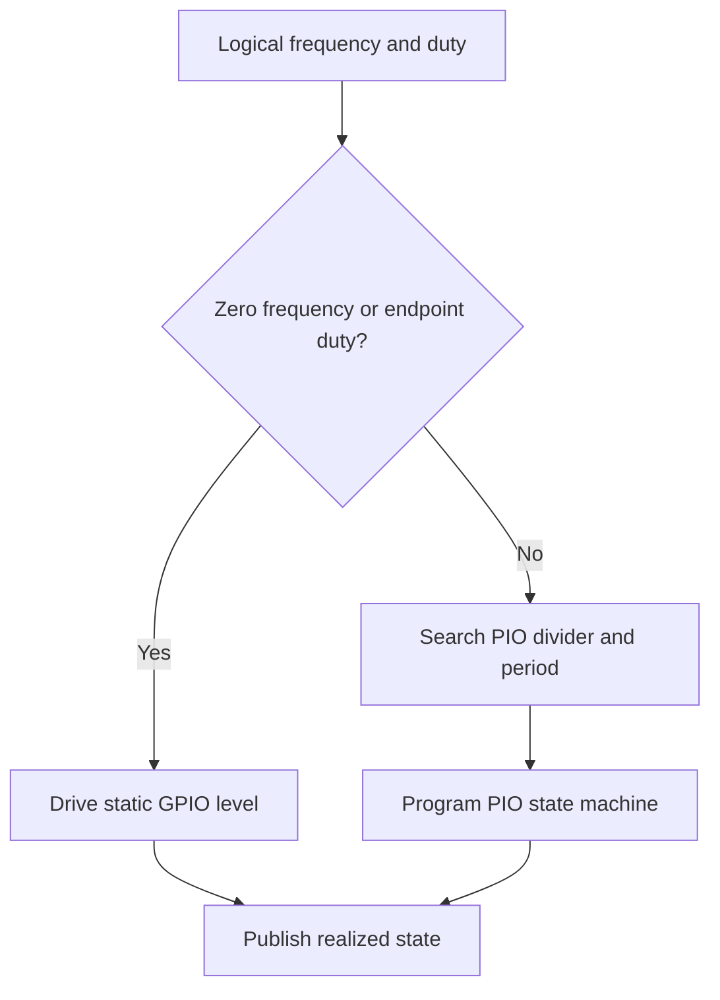
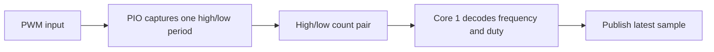

# PIO PWM Design

The PIO generator produces continuous PWM output using one PIO state machine
per configured channel. Source files:

- `firmware/src/driver/pwm/pio/pio_generator.c`
- `firmware/src/driver/pwm/pio/pio_generator.h`
- `firmware/src/driver/pwm/pio/pio_generator.pio`

## Resource Constraints

The PIO generator is capped at 8 channels total: two PIO blocks, four state
machines each. The default profile fixes these 8 channels to the 8 companion
slice-A GPIOs paired with the hardware PWM slices (`0, 2, 4, 6, 8, 10, 12,
14`); this is one fixed pin set, not a free choice among routable GPIOs. A
custom profile must still ensure that each channel has a valid PIO state
machine and routable GPIO. Generator and monitor channels must not claim the
same PIO resource.

The PIO timing divider and period counter quantize the realized frequency, so
the applied frequency may differ from the requested frequency. The profile's
current target range is about `1 Hz .. 1 MHz`.

## Operation

The compact PIO program loads a period count and duty threshold, loops
continuously, and drives the side-set output. C code selects timing values,
handles static output cases, and publishes realized frequency and duty through
`pwm`. Realized duty comes from the programmed loop (`high_iterations` over
`total_iterations`), so short periods publish a quantized duty. The timing search
lives in `pio_math.h` and is covered by a host frequency sweep.

The state machine keeps the period available across iterations and compares its
counter with the requested high-time threshold to place the output transition.
The host-side timing search selects a divider and period that approximate the
requested frequency within the PIO's representable range. Divider and period
quantization mean realized frequency and duty can differ slightly from the
request; the published state describes the applied result.

The public policy is:

- `freq_hz = 0`, `duty = 100`: static high
- `freq_hz = 0`, other duty: static low
- nonzero frequency with `duty = 0` or `100`: static output level

[PWM Driver Design](driver-design.md) covers profile routing and
mailbox ownership.

## Monitor Design

The PIO monitor measures one complete high/low period to provide an
approximate current frequency and duty reading. It is intended for sampled
state, not waveform history or continuous change tracking.

The monitor uses one state machine per active channel. A capture waits for the
input to be low, synchronizes to a rising edge, counts the high segment, then
counts the following low segment. It places both counts in the receive FIFO
only after the complete period is measured. The state machine then stops
producing samples until Core 1 reads the pair and ends the capture.
Intermediate periods are discarded. Core 1 refreshes monitor channels
periodically, so published values may lag rapid input changes.

Both the `WAIT PIN` input base and `JMP PIN` selector point to the channel's GPIO.
Before each capture, Core 1 clears the FIFO, restarts the state machine, and explicitly jumps to the
loaded program's entry point. The SDK restart operation alone does not reset the program counter;
without the jump, a completed capture remains in its terminal loop.

The finite state-machine allocation is shared with PIO generation. The
selected bank role determines which implementation owns the bank at startup;
generator and monitor activity must not claim the same PIO resources at once.
The current monitor uses direct FIFO reads and does not allocate DMA.

Monitoring intentionally retains only one latest sample. Continuous capture
with DMA would add allocation, buffer-lifetime, and recovery concerns without
serving the current readback contract. Reconsider buffering only if the product
requires capture history, trend analysis, or guaranteed observation of rapid
changes.

If a complete period is not captured before the timeout, the monitor samples
the GPIO level and reports a static state. An invalid capture is reported as
an unstable sample rather than presented as valid frequency and duty data.
This trades continuous tracking for bounded resource use and a simple
latest-value interface. CPU polling was avoided because it would consume Core 1
time while waiting; edge interrupts remain a better fit for slower software
monitoring, while PIO capture provides timing work independent of interrupt
latency.
