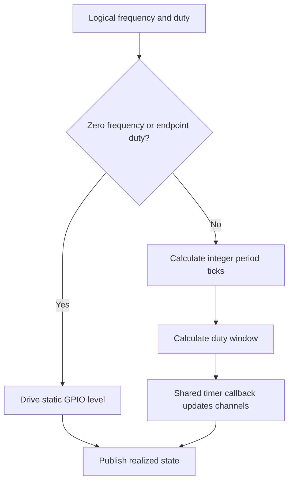
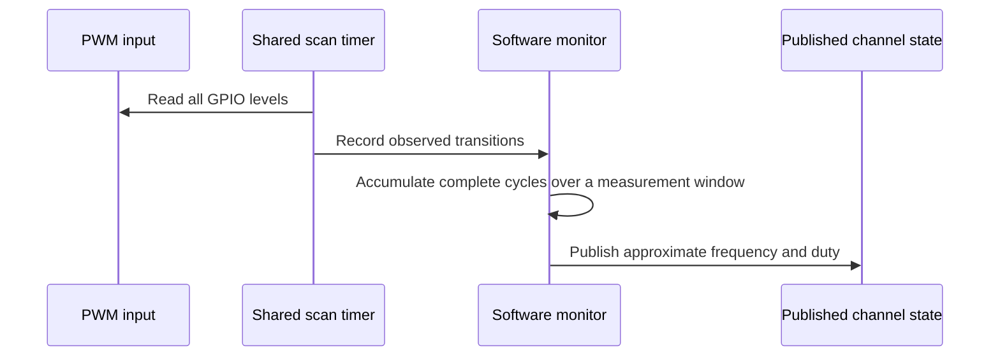

# Software PWM Design

The software generator produces PWM through one shared repeating timer and a
per-channel scheduler state. The timer runs on a private Core 1 alarm pool and is
armed only while a channel is active. Source files:

- `firmware/src/driver/pwm/software/software_generator.c`
- `firmware/src/driver/pwm/software/software_generator.h`

## Resource Constraints

Software generation does not require a fixed PWM slice or PIO state machine.
A profile may assign valid, uniquely owned GPIOs to software channels, but the
practical channel count is limited by Core 1 CPU time, timer callback work,
and interrupt load.

The current scheduler tick is `10 us`, producing a `100 kHz` base tick. The
recommended generator range is about `1 Hz .. 1 kHz`; period and duty are
quantized to integer scheduler ticks.

### Generator Maximum and Duty Resolution

The **firmware generator ceiling is 10 kHz**, with operation above 1 kHz
experimental; the recommended range remains 1 Hz to 1 kHz. The generator
retains its 10 us tick, independently of the monitor's 2 us scan delay.
A nominal 100 kHz scheduler could represent a two-tick
50 kHz waveform with only 0%, 50%, and 100% duty, but that is a timing-grid
limit, not an accepted request or sustainable hardware-verified output.
There is no qualified absolute software-generation maximum: timer latency and
eight-channel callback cost must also be considered.

The current generator rounds `N = 100000 / frequency` to an integer, then
rounds the high time to an integer number of ticks. One tick is `100/N`
percentage points of duty.

| Requested frequency | Nominal ticks per period N | Duty step (percentage points) | Status |
| --- | ---: | ---: | --- |
| 1 Hz | 100000 | 0.001 | Accepted |
| 10 Hz | 10000 | 0.01 | Accepted |
| 100 Hz | 1000 | 0.1 | Accepted |
| 500 Hz | 200 | 0.5 | Accepted |
| 1 kHz | 100 | 1 | Recommended ceiling |
| 2 kHz | 50 | 2 | Experimental |
| 5 kHz | 20 | 5 | Experimental |
| 10 kHz | 10 | 10 | Accepted experimental ceiling |
| 50 kHz | 2 | 50 | Timing-grid maximum for toggling; rejected |

Sub-1-percentage-point tick resolution does not add fractional-percent API
control. The table assumes ideal timer servicing; missed deadlines and GPIO
update latency can change the physical waveform. Readback is a scheduler model,
not an independent output measurement. Static 0% and 100% output has no oscillation frequency.

## Operation

The shared callback visits active software channels, advances their counters,
and updates GPIO outputs. Static output cases bypass the scheduled path:

- `freq_hz = 0`, `duty = 100`: static high
- `freq_hz = 0`, other duty: static low
- nonzero frequency with `duty = 0` or `100`: static output level

Software generation is intentionally the simple, low-frequency backend. Use
hardware PWM or PIO for tighter timing accuracy or higher-frequency output.

## Monitor Design

The software monitor samples all eight inputs with one GPIO bitmap read in a
private Core 1 alarm-pool callback. It requests a 2 us delay after each callback
completes, avoiding catch-up interrupt bursts if servicing is delayed. Actual
microsecond timestamps, not assumed tick counts, measure observed transitions.
Input frequency does not increase the callback rate. A precomputed GPIO mask
and lookup table restrict processing to owned pins that changed; scans with
no observed changes do not visit channel capture state.

Complete rising-to-rising cycles and their high times accumulate over at least
20 ms. A cycle lasting at least 20 ms publishes on its own, discarding any
unfinished faster-cycle accumulation so a transition to a slow input does not
inflate its first complete-cycle reading. Core 1 calculates
frequency as cycle count divided by elapsed time, and duty as accumulated high
time divided by elapsed time, outside the timer callback. This reduces
single-period timestamp jitter without hiding changes through display rounding.

Software monitoring does not require a fixed PWM slice or PIO state machine.
It does not enable per-edge GPIO interrupts. Timer work is bounded to eight
channels per scan, with no division inside the callback. Its practical limits
are scan spacing, CPU time, and timestamp granularity. The conservative intended
range is `1 Hz .. 1 kHz`, with an experimental target extending to 10 kHz.
The generator's separate experimental ceiling is also 10 kHz. Use hardware or PIO monitoring for
higher-frequency or higher-accuracy measurements.

The 2 us delay is not an accuracy guarantee: callback execution and interrupt
latency increase scan spacing. Narrow high or low pulses may be missed even at
an otherwise supported frequency. Out-of-range inputs can alias to false lower
frequencies or static levels; the sampler cannot reliably identify all such
inputs. High-frequency input no longer causes per-edge interrupt starvation,
but responsiveness and accuracy still require physical validation.

If no scan has arrived for at least one second, the backend returns no valid
sample rather than classifying an old GPIO level as static. The driver publishes
0 Hz / 0% for an unavailable sample; the existing channel-state format does not
distinguish this from a measured static LOW. A valid static HIGH result requires
a recent scan, but cannot rule out pulses missed between scans.

### Experimental 10 kHz Target and Scan Diagnostics

The experimental target is 1 Hz to 10 kHz, frequency error within 5% and duty
error within 5 percentage points, for 10% to 90% duty. This is not a qualified
specification. At 10 kHz a 10% pulse lasts only 10 us; approximately 5 us or
better actual scan spacing is a timing budget to investigate, not proof of
accuracy. Multi-cycle averaging cannot recover missed pulses.

### Low-Frequency Loopback Observation

An operator reported unstable software-monitor readings in a 2 Hz
PIO-to-software loopback. The cause remains unresolved. The README therefore
recommends starting PIO and software measurement at 10 Hz as a precaution,
not as a verified accuracy floor. Measurement below 10 Hz remains experimental
and needs independent instrument verification.

### Operator-Reported Functional Check

On 2026-10-29, the operator reported that the updated software monitor was
working with eight channels on a Pico at 125 MHz. This is a user-reported
functional observation, not an automated HIL pass or independent accuracy
measurement.

The report did not specify test frequencies, duty settings, measured errors,
scan-spacing diagnostics, firmware artifact identity, or an independent
instrument reference. It therefore does not establish the full 1 Hz to 10 kHz,
10% to 90% duty accuracy target, Pico 2 behavior, or qualification at other clocks.
Retain the experimental designation until those checks are recorded.

### Monitor Frequency Versus Pulse Width

The 2 us completion-relative delay is not the actual scan interval and does not
establish a 250 kHz input limit. Even with perfectly uniform scans spaced
`S` apart, a 50% signal needs a period longer than `2S` to avoid regularly
missing entire levels. Asynchronous or delayed scans require more margin.
There is no reliable absolute maximum for arbitrary duty cycles without a
measured bound on scan gaps.

| Input frequency | Period | High/low at 50% duty | Shortest segment at 10% or 90% duty | 5 us gap as fraction of period |
| --- | ---: | ---: | ---: | ---: |
| 1 Hz | 1 s | 500 ms | 100 ms | 0.0005% |
| 100 Hz | 10 ms | 5 ms | 1 ms | 0.05% |
| 1 kHz | 1 ms | 500 us | 100 us | 0.5% |
| 5 kHz | 200 us | 100 us | 20 us | 2.5% |
| 10 kHz | 100 us | 50 us | 10 us | 5% |
| 20 kHz | 50 us | 25 us | 5 us | 10% |

The last column illustrates a time-quantization budget, not an error guarantee.
At 10 kHz and 10% duty, even a 5 us gap leaves only about two sampling
opportunities in the short segment. At 20 kHz that segment can be missed.
Averaging can reduce frequency endpoint error but cannot remove phase-locked
duty bias or aliasing. Below approximately 1 Hz the one-second inactivity
timeout can classify a long segment as static.

The debugger-visible `sw_mon_scan_timing` in `software_monitor.c` records
lifetime `scans`, `min_gap_us`, `max_gap_us`, and `gaps_over_5us`. Counts saturate
at `UINT32_MAX`; the minimum remains `UINT32_MAX` until a second scan occurs.
Halt Core 1 before inspecting the struct for a coherent snapshot. Firmware
tests can use the Core 1-only `sw_mon_get_scan_timing()` helper; higher layers
must not bypass the PWM driver boundary. These diagnostics are not exposed
through CDC or HID and are not total CPU utilization.

Gaps include interrupt delays and flash stalls. Check timing with all eight
inputs active, then compare frequency and duty against an independent instrument
at multiple phases and duty cycles, including 10% and 90%. The hardware-free
tests exercise the error thresholds at simulated 4 us and variable 3 to 5 us spacing but do not
establish achievable spacing on Pico or Pico 2. Verify command responsiveness
under load before treating the faster scan as suitable for deployment.

If no transition is observed for more than one second, the monitor reports a
static input as `0 Hz` with duty `0%` or `100%`, based on the sampled level.
