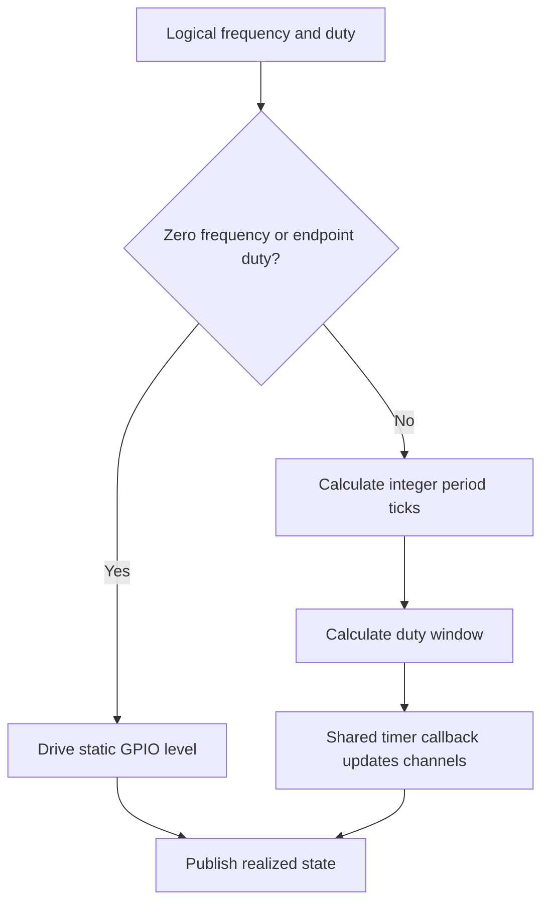
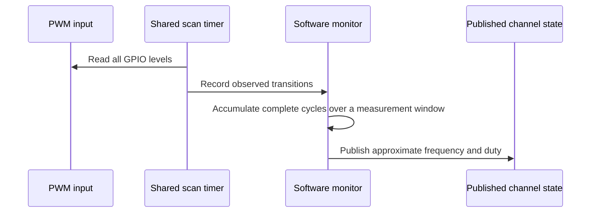

# Software PWM Design

The software generator produces PWM through one shared repeating timer and a
per-channel scheduler state. The timer runs on a private Core 1 alarm pool and is
armed only while a channel is active. Source files:

- `firmware/src/driver/pwm/software/software_generator.c`
- `firmware/src/driver/pwm/software/software_generator.h`

## Resource Constraints

Software generation does not require a fixed PWM slice or PIO state machine.
A profile may assign valid, uniquely owned GPIOs to software channels, but the
practical channel count is limited by Core 1 CPU time, timer callback work,
and interrupt load.

The current scheduler tick is `10 us`, producing a `100 kHz` base tick. The
recommended generator range is about `1 Hz .. 1 kHz`; period and duty are
quantized to integer scheduler ticks.

## Operation

The shared callback visits active software channels, advances their counters,
and updates GPIO outputs. Static output cases bypass the scheduled path:

- `freq_hz = 0`, `duty = 100`: static high
- `freq_hz = 0`, other duty: static low
- nonzero frequency with `duty = 0` or `100`: static output level

Software generation is intentionally the simple, low-frequency backend. Use
hardware PWM or PIO for tighter timing accuracy or higher-frequency output.

## Monitor Design

The software monitor samples all eight inputs with one GPIO bitmap read in a
private Core 1 alarm-pool callback. It requests a 10 us delay after each callback
completes, avoiding catch-up interrupt bursts if servicing is delayed. Actual
microsecond timestamps, not assumed tick counts, measure observed transitions.
Input frequency does not increase the callback rate.

Complete rising-to-rising cycles and their high times accumulate over at least
20 ms. Lower-frequency signals publish after a complete cycle. Core 1 calculates
frequency as cycle count divided by elapsed time, and duty as accumulated high
time divided by elapsed time, outside the timer callback. This reduces
single-period timestamp jitter without hiding changes through display rounding.

Software monitoring does not require a fixed PWM slice or PIO state machine.
It does not enable per-edge GPIO interrupts. Timer work is bounded to eight
channels per scan, with no division inside the callback. Its practical limits
are scan spacing, CPU time, and timestamp granularity. The intended range is about `1 Hz .. 1 kHz`,
subject to the selected profile's limits. Use hardware or PIO monitoring for
higher-frequency or higher-accuracy measurements.

The 10 us delay is not an accuracy guarantee: callback execution and interrupt
latency increase scan spacing. Narrow high or low pulses may be missed even at
an otherwise supported frequency. Out-of-range inputs can alias to false lower
frequencies or static levels; the sampler cannot reliably identify all such
inputs. High-frequency input no longer causes per-edge interrupt starvation,
but responsiveness and accuracy still require physical validation.

If no transition is observed for more than one second, the monitor reports a
static input as `0 Hz` with duty `0%` or `100%`, based on the sampled level.
