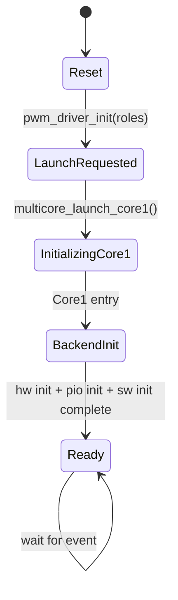
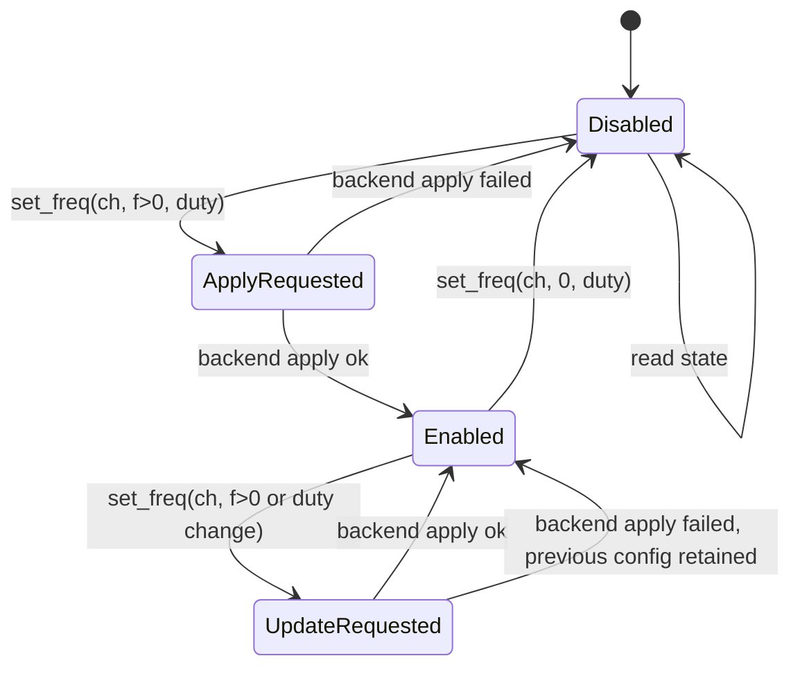
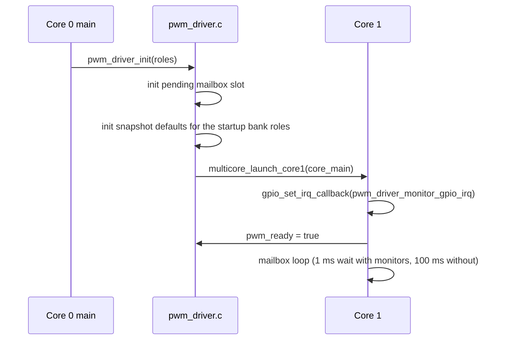
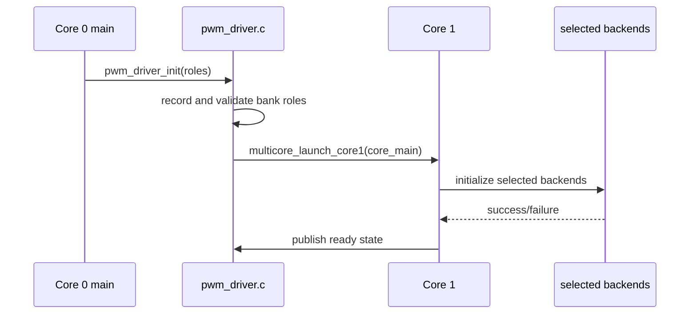
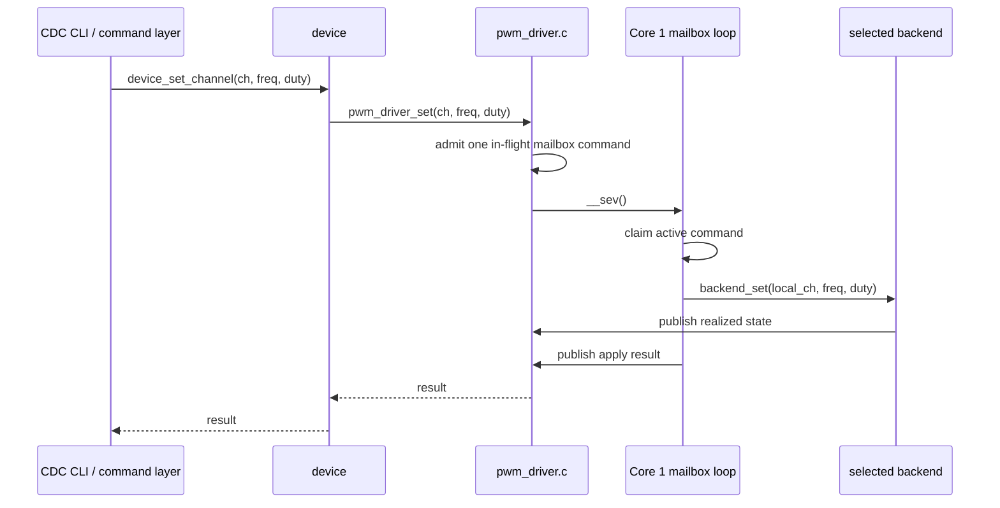
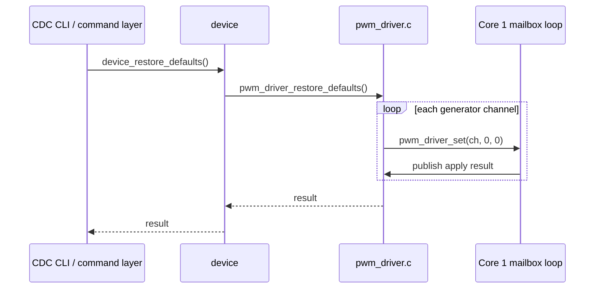
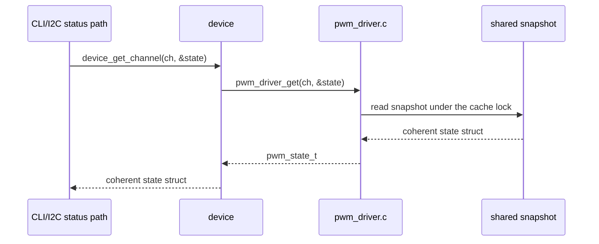

# PWM Driver Detailed Design

This document describes the detailed design of the `pwm` subsystem in the current PicoPWM firmware.

The focus of this page is:

- subsystem responsibilities
- cross-core separation
- mailbox and snapshot behavior
- state machines
- API call sequences
- detailed behavior of each PWM backend

This document is implementation-oriented and follows the current firmware under `firmware/src/driver/pwm/`.

## Scope

The `pwm` subsystem provides one logical channel service. The default
profile currently exposes 24 channels, but backend ownership and direction are
resolved from the startup bank configuration and `config/board.c`.

It is responsible for:

- owning all PWM backend state on Core 1
- translating logical channel IDs to backend-local channel IDs
- accepting command-path frequency and duty updates from Core 0
- publishing realized channel state for readback
- hiding backend-specific timing details from higher layers

It is not responsible for:

- parsing CLI commands
- I2C transport framing
- user-facing validation policy beyond basic driver-side checks

## Design Goals

The subsystem is designed around the following goals:

1. Keep communication and user interface handling on Core 0.
2. Keep PWM timing engines, IRQs, and backend state on Core 1.
3. Expose one logical channel model to higher layers.
4. Separate command submission from backend implementation details.
5. Publish realized state rather than maintaining a second shadow model in a separate control layer.

## Source Layout

The current implementation is split as follows:

| File | Responsibility |
| ------ | ---------------- |
| `firmware/src/device.h` | Shared Core 0 device API surface used by CDC and I2C |
| `firmware/src/device.c` | Shared device info, channel reads, and channel write helpers above the Core 1 mailbox boundary |
| `firmware/src/app/i2c/i2c_control_map.h` | I2C register map definitions and protocol helpers |
| `firmware/src/app/i2c/i2c_control_map.c` | I2C register encode/decode and deferred write translation into `device` |
| `firmware/src/driver/pwm/pwm_driver.h` | Public wrapper API, bank/role types, board GPIO structs and channel capacity constants |
| `firmware/src/driver/pwm/pwm_driver.c` | Core 1 launch, mailbox loop, bank roles, channel lookups, frequency limits, board GPIO validation, shared snapshot |
| `firmware/src/platform/boot_config.[ch]` | Persisted clock profile, bank roles and I2C address (CRC-protected flash record) |
| `firmware/src/driver/pwm/hardware/hardware_generator.c` | Hardware PWM generator backend |
| `firmware/src/driver/pwm/hardware/hardware_monitor.c` | Hardware PWM monitor backend |
| `firmware/src/driver/pwm/pio/pio_generator.c` | PIO generator backend |
| `firmware/src/driver/pwm/pio/pio_generator.pio` | PIO assembly program used by the PIO generator backend |
| `firmware/src/driver/pwm/pio/pio_monitor.c` | PIO monitor backend |
| `firmware/src/driver/pwm/pio/pio_monitor.pio` | PIO assembly program used by the PIO monitor backend |
| `firmware/src/driver/pwm/software/software_generator.c` | Software PWM generator backend |
| `firmware/src/driver/pwm/software/software_monitor.c` | Software PWM monitor backend |

## External Interface

The transport-facing control/status layer is:

```c
const char *device_name(void);
const char *device_firmware_version(void);
uint8_t device_channel_count(void);
bool device_get_channel(uint channel, pwm_state_t *state);
pwm_driver_result_t device_set_channel(uint channel, uint32_t freq_hz, uint8_t duty);
pwm_driver_result_t device_restore_defaults(void);
```

Below that, `pwm` owns the internal cross-core mailbox boundary used by `device`:

```c
bool pwm_driver_init(const pwm_role_t roles[PWM_BANK_COUNT]);
bool pwm_driver_is_ready(void);
```

The internal Core 0 control layer uses the following mailbox API:

```c
pwm_driver_result_t pwm_driver_set(uint channel, uint32_t freq_hz, uint8_t duty);
bool pwm_driver_get(uint channel, pwm_state_t *state);
pwm_driver_result_t pwm_driver_restore_defaults(void);
```

The shared state type is:

```c
typedef struct {
    uint32_t freq_hz;
    uint8_t duty;
} pwm_state_t;
```

### API Intent

Architecturally, `pwm_driver_set()` is an internal command-ingress API.

- Top-level command paths such as the CDC CLI and I2C register map should enter through `device`.
- The I2C write path should continue to defer out of the ISR before it reaches this mailbox API.
- It is not intended as a general-purpose helper for arbitrary internal call sites.
- Core 1 callers must not use this API; it returns `PWM_DRIVER_RESULT_UNAVAILABLE` outside the Core 0 command path.
- Public write callers first pass through the shared Core 0 serialization lock before they compete for mailbox admission.
- Core 0 waits for Core 1 to finish the backend apply step before returning.
- The wrapper returns `PWM_DRIVER_RESULT_INVALID` for invalid channel or unsupported frequency requests.
- The wrapper returns `PWM_DRIVER_RESULT_UNAVAILABLE` if Core 1 is not ready yet.
- The wrapper returns `PWM_DRIVER_RESULT_TIMEOUT` when the command is still unclaimed at the apply deadline. Core 0 cancels that command and it is not applied. If Core 1 has already claimed it, Core 0 keeps waiting and returns the published result. A stalled Core 1 heartbeat during that wait reboots the board.
- The wrapper returns `PWM_DRIVER_RESULT_APPLY_FAILED` if Core 1 accepts the command but the backend rejects it.
- `pwm_driver_restore_defaults()` has no mailbox command of its own: it calls `pwm_driver_set(ch, 0, 0)` for every generator channel and returns the first failure.

## Current Default Mapping

Every bank maps to the same fixed logical channel range. Startup configuration
selects its backend family and role:

| Logical Channel | Backend when locked as generator | Backend when locked as monitor |
| ----------------- | --------- | ----------------------- |
| `0..7` (Bank A) | HW generator | HW monitor |
| `8..15` (Bank B) | PIO generator | PIO monitor |
| `16..23` (Bank C) | SW generator only | SW monitor only |

The physical mapping and slice assignments are documented in
[Pinout](../guides/pinout.md). Startup bank configuration is documented in
[Firmware Configuration](../guides/configuration.md#startup-bank-configuration).

## Internal Separation

The subsystem has four internal layers.

### 1. Transport Layer

Owned by the CDC CLI and I2C transport modules.

Responsibilities:

- parse transport-specific requests
- format transport-specific responses
- avoid backend access and multicore synchronization details

For I2C specifically, the transport layer includes an ISR-facing slave module and a register-map helper that translates binary registers into shared control-layer operations.

### 2. Shared Control Layer

Owned by `firmware/src/device.c`.

Responsibilities:

- expose one shared Core 0 control/status API to both transports
- centralize device identity and version reporting
- centralize logical channel reads and writes above `pwm`
- avoid maintaining a second shadow copy of realized channel state

This layer reads realized state from `pwm_driver_get()` and forwards writes through the internal `pwm` mailbox API.

It does not own I2C register numbers or binary payload layout. Those protocol details live in `firmware/src/app/i2c/i2c_control_map.c`.

### 3. Wrapper Layer

Owned by `pwm_driver.c`.

Responsibilities:

- serialize public write entry points on Core 0
- own mailbox admission and reply waiting for the internal `pwm_driver_set()` and `pwm_driver_restore_defaults()` APIs

This layer does not know backend-specific register or timing details.

This layer is the architectural boundary between the shared Core 0 control plane and backend-specific code.

### 4. Backend Layer

Owned by the selected profile's generator or monitor modules:

- `hardware/hardware_generator.c` and `hardware/hardware_monitor.c`
- `pio/pio_generator.c` and `pio/pio_monitor.c`
- `software/software_generator.c` and `software/software_monitor.c`

Responsibilities:

- own backend timing configuration
- own backend-local state
- manage backend IRQ or timer behavior
- publish realized state after successful changes

### 5. Hardware/Runtime Layer

Owned by the Pico SDK and the MCU peripherals.

Resources used:

- PWM slices
- GPIO edge IRQs for hardware and software monitor channels
- PIO programs, state machines, and IRQs
- one repeating timer on a private Core 1 alarm pool for software PWM, armed only while a channel is active
- multicore event signaling

## Core Ownership Model

### Core 0

Core 0 owns:

- USB CDC transport
- I2C slave transport
- CLI command parsing and formatting
- shared control/status translation
- status formatting and reporting

Core 0 reads channel state through `pwm_driver_get()`.

### Core 1

Core 1 owns:

- all PWM backend initialization
- all backend-local timing configuration
- all PWM-related IRQ handling
- the software PWM timer callback
- shared snapshot publication

Core 0 must not call backend driver functions directly.

## High-Level State Machine

The `pwm` wrapper has a small lifecycle state machine.



### State Descriptions

| State | Meaning |
| ------ | --------- |
| `Reset` | Static memory and snapshot defaults only |
| `LaunchRequested` | Core 0 requested Core 1 startup |
| `BackendInit` | Core 1 is initializing all backends |
| `Ready` | Mailbox processing and PWM service active |

## Per-Channel Operational State Machine

Each logical channel behaves like this from the wrapper point of view.



This is a logical model. Backend-specific internal state differs by driver.

## API Sequence Diagrams

### `pwm_driver_init()`



All selected backends initialize during startup from the supplied configuration.

### `pwm_driver_init()` startup configuration



### `device_set_channel()` to `pwm_driver_set()`



### `device_restore_defaults()` to `pwm_driver_restore_defaults()`



### Read Path



The coherent higher-layer read boundary is `device_get_channel()`, which forwards one channel snapshot from `pwm_driver_get()`.

## Mailbox Command Structure

The wrapper uses one single-slot mailbox record containing:

- operation kind
- logical channel for set-channel commands
- requested frequency for set-channel commands
- requested duty for set-channel commands

Only one command is in flight at a time: the Core 0 serialization lock admits one writer, and Core 0 waits until
its command is applied, so no `BUSY` result is produced here (`PWM_DRIVER_RESULT_BUSY` remains the I2C queued-write status).

The slot is one struct of three flags plus the command, all guarded by the reply critical section:

- `pending`: published by Core 0, not yet claimed. Core 1 clears it when it claims the command.
- `done`: Core 1 finished applying the command.
- `ok`: the backend result, valid when `done` is set.

`!pending && !done` therefore means Core 1 is applying the command. Core 0 may cancel only while `pending` is still set,
at the apply deadline.

The mailbox carries control mutations and their result status. It does not
carry real-time PWM edges or monitor samples; those remain local to Core 1 and
are exposed through the realized-state snapshot.

### Responsibilities of `pwm_driver.c`

`pwm_driver.c` performs the following functions.

1. Profile-table channel routing.
2. Profile-based mapping from logical channel number to backend and backend-local index.
3. Core 1 launch and ready-state control.
4. Mailbox state transitions for the one-slot Core 0/Core 1 command exchange.
5. Reply publication for the active Core 0 command.
6. Shared-state publication.
7. Readback through the locked snapshot.
8. Backend initialization on Core 1 from the startup bank configuration.

### Logical Routing

Routing is resolved on demand: `channel / 8` selects the fixed module
(A=hardware, B=pio, C=software), the startup role selects its generator or
monitor variant, `channel % 8` is the module-local index, and each module reads
its GPIOs from its `board.c` const. There is no stored table. The
default profile currently exposes 24 channels, but higher layers must not
infer backend ownership from a channel-number range.

Each descriptor owns:

- backend initialization and channel operations
- generator `set()` and restore callbacks when the channel is output-capable
- monitor read callbacks when the channel is input-capable

### Shared Snapshot Design

Each logical channel has one published `pwm_state_t` (`freq_hz`, `duty`) in a cache guarded by one
`critical_section_t` (a hardware spinlock plus local interrupt mask, so it is safe across cores and from the
Core 1 timer ISR). Writers (`pwm_driver_store_applied_state()`) and the reader (`pwm_driver_get()`) hold it only for one
struct copy, so the pair is never torn and no retry loop exists. The cache is zero (`0 Hz`, `0%`) until a backend
publishes.

Core 1 refreshes monitor channels about every 1 ms (skipped entirely when no bank is a monitor; the loop then wakes on submit or every 100 ms) but republishes a channel only when its sample changed, so a
monitor whose value is stable costs one compare per channel.

A monitor with no valid sample (signal lost, or nothing captured yet) is published as `0 Hz, 0%`, never as the last
valid sample. `0 Hz` therefore means "no periodic signal" for a monitor; the duty of a static input is reported by
backends that can sample the level.

## Hardware PWM Summary

The hardware PWM implementation is now split into:

- `firmware/src/driver/pwm/hardware/hardware_generator.c` for the integrated generator backend
- `firmware/src/driver/pwm/hardware/hardware_monitor.c` for the hardware monitor backend

The integrated generator backend:

- accepts integer `freq_hz` and integer duty percent
- uses one PWM slice per logical hardware channel
- treats `freq_hz = 0` as a static-output policy case
- publishes realized `freq_hz` and `duty` as the external read model

The hardware monitor backend:

- measures the same slice-B pins with the PWM slice counters in input mode
- alternates a rising-edge window (frequency) and a high-time window (duty)
- refreshes a sample about every 500 ms and is reliable above about 20 Hz

For the current hardware timing equations, counter-width limits, divider limits, and the recommended operating range, see [Hardware PWM Generator](generator/hardware_generator.md). For input measurement limits, see [Hardware PWM Monitor](monitor/hardware_monitor.md).

## Software PWM Summary

The software PWM implementation is now split into:

- `firmware/src/driver/pwm/software/software_generator.c` for the integrated generator backend
- `firmware/src/driver/pwm/software/software_monitor.c` for the software monitor backend

The integrated generator backend:

- accepts integer `freq_hz` and integer duty percent
- uses one shared software scheduler tick for the software channel bank
- treats `freq_hz = 0` and endpoint duties as static-output policy cases
- publishes realized `freq_hz` and `duty`
- owns the software-PWM maximum frequency policy directly in the backend

The software monitor backend:

- measures the same slice-B pins with the PWM slice counters in input mode
- alternates a rising-edge window (frequency) and a high-time window (duty)
- refreshes a sample about every 500 ms and is reliable above about 20 Hz
- owns software-monitor channels selected by the active profile

For the current software timing model, target range, and monitor role, see [Software PWM Generator](generator/software_generator.md) and [Software PWM Monitor](monitor/software_monitor.md).

## PIO Generator Detailed Design

### Purpose

The PIO backend provides better timing quality than software PWM without consuming the dedicated hardware PWM slice bank.

### Resource Allocation

- 8 logical channels
- distributed over `pio0` and `pio1`
- 4 state machines on each PIO block
- one output pin per state machine
- no per-period IRQ or DMA path in the current generator implementation

### Channel Distribution

| Local Channel | PIO | State Machine |
| --------------- | ----- | --------------- |
| 0 | `pio0` | 0 |
| 1 | `pio0` | 1 |
| 2 | `pio0` | 2 |
| 3 | `pio0` | 3 |
| 4 | `pio1` | 0 |
| 5 | `pio1` | 1 |
| 6 | `pio1` | 2 |
| 7 | `pio1` | 3 |

### PIO Program Role

The PIO program:

1. loads a duty level and a period value
2. compares the running counter against the desired level
3. drives the side-set output high or low
4. loops with the period cached in `ISR` until the channel is reconfigured

### Initialization

Initialization steps:

1. load the PIO program into each used PIO block once
2. assign each logical channel to one PIO block and one state machine
3. initialize output GPIO low
4. initialize per-channel cached timing state

### Timing Search

The PIO driver computes timing by searching `period_count` and deriving a quantized `clkdiv`.

In steady state, one PWM period costs:

$$
cycles\_per\_period = 3 \times (period\_count + 1) + 2
$$

The `+2` term comes from the `mov y, isr` reload and the `jmp restart` at the end of each period. The two initial `pull` instructions are startup cost only and are not part of steady-state frequency calculation.

For each candidate `period_count`:

1. compute cycles per period used by the program
2. derive the ideal divider from system clock and target frequency
3. quantize divider to PIO fractional precision
4. compute realized frequency
5. track the minimum error solution

The driver rejects requests that cannot be represented within PIO period and divider constraints.

The current generator firmware also rejects requests above `1 MHz` so the backend behavior stays aligned with the documented intended operating range.

### Enable Sequence

When enabling or updating a channel, the backend first resolves one target mode:

- static low
- static high
- running PWM

Then one internal apply helper performs the full transition for that resolved mode:

1. either drive a static SIO level or program and enable the PIO state machine
2. publish the resulting realized frequency and duty

The static-output rule (`pwm_generator_resolve_static` in `pwm_math.h`) is shared by the hardware, PIO and software
generators. The PIO divider and period search (`pwm_pio_find_timing` in `pio_math.h`) is pure integer math covered by
a host frequency sweep; divider quantization near a divider of 1 bounds the realized error at about 0.2%.

### Disable Sequence

There is no separate disable-only apply path now. A disable or endpoint-duty request is handled by
resolving one static target mode and applying it through the same internal helper used by PWM-mode
updates.

## Software PWM Driver Detailed Design

### Purpose

The software PWM backend provides the lowest-cost implementation for slower frequencies.

### Resource Allocation

- 8 output GPIOs
- one private alarm pool created on Core 1 and one repeating timer, armed on demand
- one per-channel runtime struct

### Timing Base

- timer period: `10 us`
- base rate: `100000 Hz`

Requested frequency is converted to a period measured in timer ticks.

$$
period\_ticks \approx \frac{100000}{f_{req}}
$$

Realized frequency becomes:

$$
f_{real} = \frac{100000}{period\_ticks}
$$

### Channel Runtime State

Each software channel stores:

- GPIO number
- `period_ticks`
- `duty_ticks`
- running counter

Channel activity is tracked separately by the backend-wide `sw_pwm_active_mask` rather than by a
per-channel active field.

### Initialization

For each channel:

1. assign GPIO
2. clear period and duty tick values
3. clear counter
4. leave the channel out of the active mask
5. initialize GPIO as output low

After channel setup the backend creates a private alarm pool with `alarm_pool_create_with_unused_hardware_alarm()`.
Init runs on Core 1, and the SDK services a pool's alarms on the core that created it, so the tick interrupt runs on
Core 1. The default pool belongs to Core 0 and would run the tick there, racing the Core 1 writers. No timer runs yet.

### Set-Frequency Behavior

When applying a new configuration:

1. clamp duty to `0.0..1.0`
2. if `freq_hz <= 0`, remove the channel from the active mask and drive a static level
3. otherwise compute `period_ticks`
4. compute `duty_ticks`
5. compute realized frequency and realized duty (`duty_ticks` over `period_ticks`, rounded)
6. protect shared channel timing fields with interrupt masking
7. write timing fields and reset the per-channel running counter
8. add the channel to the active mask
9. if the tick timer is not armed, arm it at `10 us` on the private pool (still on Core 1)
10. publish the realized state

### Timer Callback Behavior

On every timer tick:

1. iterate through all software channels
2. skip inactive channels
3. increment running counter
4. when counter reaches period, reset counter
5. drive GPIO high while `counter < duty_ticks`, otherwise low

When no channel is active the callback clears the running flag and returns `false`, which disarms the timer. A board
whose software bank is idle or static therefore takes no tick interrupts.

### Concurrency Handling

The timer callback and set-frequency path both touch channel timing fields.

Protection method:

- `save_and_disable_interrupts()` before update
- write timing fields and update the active-mask membership
- `restore_interrupts()` after update
- publish the realized snapshot after the update (the timer never changes the published fields)

This keeps the callback from observing partially updated configuration.

## Snapshot Publication Model

Backends publish state through one helper function in `pwm_driver.c`.

### `pwm_driver_store_applied_state()`

Used after a successful apply of:

- new frequency
- new duty
- disable request

Published fields:

- realized `freq_hz`
- realized `duty`

## Readback Semantics

The architectural intent is that the `pwm` snapshot is the single source of truth for logical channel state.

Important readback properties:

- values are realized backend values, not merely requested values; frequency is rounded to the nearest achievable
  one and duty is derived from the integer step counts that program the output, so callers read both back
- a static request (zero frequency, `0%` or `100%`) is published as `0 Hz` with a realized duty of `0` or `100`, for
  every generator backend
- `stop` disables generator output
- callers should prefer a single state-struct read when they need coherent multi-field data

## Failure and Boundary Conditions

### Common Wrapper-Level Rejections

The wrapper rejects:

- invalid channel index
- unsupported mailbox operation kind

### Backend-Level Rejections

Hardware PWM may reject invalid channel numbers.

PIO PWM may reject frequencies that cannot be represented by the program timing search.

Software PWM owns its own maximum supported frequency policy and resolves static outputs to the
driven realized level in published state.

Launch-time cache seeding uses the same shared logical default as backend restore-defaults:

- `freq_hz = 0`
- `duty = 0`

### Mailbox Pressure

The wrapper accepts one in-flight mailbox command at a time.

The public write layer also keeps a small Core 0 mutex around the write entry points so only one mailbox submission path can compete for the single-slot command record at a time.

After admission, the caller waits synchronously for the Core 1 reply, up to the apply timeout. If the command is still unclaimed when that deadline expires, Core 0 cancels it and returns `PWM_DRIVER_RESULT_TIMEOUT`; the command will not be applied. If Core 1 has already claimed it, Core 0 keeps waiting and returns the published result. A stalled Core 1 heartbeat during that wait reboots the board.

Restore-defaults is a loop of per-channel stop requests through the normal setter path.

## Design Constraints and Assumptions

The current design assumes:

1. Core 0 is the normal producer of `pwm_driver_set()` and `pwm_driver_restore_defaults()` requests through `device`.
2. Backend drivers remain Core 1 implementation details.
3. CDC CLI and I2C both use the same shared Core 0 control facade.
4. The shared snapshot is the only read model exposed upward.

I2C writes should continue to defer out of ISR context before they enter `device` and the internal `pwm` mailbox boundary.

## Startup Bank Configuration

`pwm_driver.c` records the per-bank role passed to
`pwm_driver_init()` before Core 1 starts and resolves channels from them. There is no
bank-lock mailbox operation; one firmware image reaches all 8 bank-role
combinations by selecting roles in the startup configuration.

## Summary

The `pwm` subsystem is a logical-channel wrapper around three different PWM timing engines.

Its main value is not the backends themselves, but the separation it enforces:

- Core 0 handles user-facing command and status paths.
- Core 1 owns timing, hardware state, and backend implementation details.
- One logical API and one realized-state snapshot are shared upward.

This allows higher layers to think in terms of logical channels while still using the best available timing engine per channel class.
