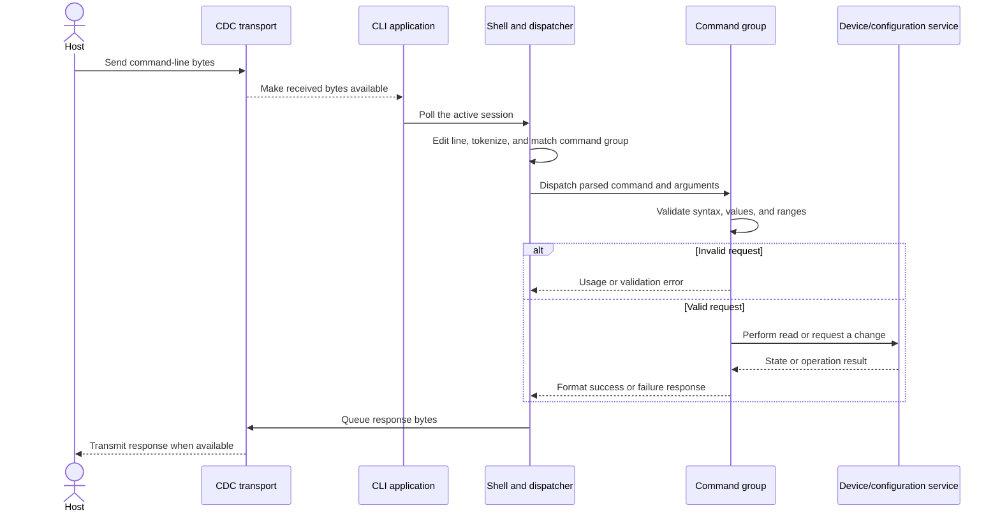

# USB CDC CLI Design

This document describes the design principles for the USB CDC command-line
interface and the workflow for extending it. It is intended for firmware
developers. User-facing syntax and behavior are documented in the
[USB CDC shell guide](../../guides/usb_cdc_shell.md).

The design is described in terms of responsibilities and boundaries rather
than specific functions or source-file names. Those implementation details may
change; the ownership rules and behavior between layers should remain stable.

## Design Goals

- Keep the shell useful for interactive users and simple host scripts.
- Keep USB transport concerns separate from command meaning and device control.
- Reuse the same device-level behavior as other control interfaces where
  applicable.
- Keep input, output, and per-session state bounded.
- Make invalid requests and failed operations visible to the user.
- Allow new command groups to be added without making the system entry point
  or transport layer responsible for command details.

## Structure and Ownership

```mermaid
flowchart LR
    Host[Terminal or host script]

    subgraph Core0[Core 0]
        Transport[CDC byte transport]
        Application[CLI application lifecycle]
        Shell[Line editor and command dispatcher]
        Groups[Command groups]
        Control[Shared device and configuration services]
    end

    Boundary{{PWM ownership boundary}}

    subgraph Core1[Core 1]
        Runtime[Channel runtime and backends]
        State[(Realized channel state)]
    end

    Host -->|input bytes| Transport
    Transport -->|received bytes| Application
    Application -->|poll active shell session| Shell
    Shell -->|parsed command and arguments| Groups
    Groups -->|validated operation| Control
    Control -->|channel mutation| Boundary
    Boundary --> Runtime
    Runtime --> State
    State -->|realized state| Control
    Control -->|operation result or state| Groups
    Groups -->|response text| Shell
    Shell -->|output bytes| Transport
    Transport -->|CDC data| Host
```

### Responsibilities

| Area | Owns | Should not own |
| --- | --- | --- |
| CDC transport | USB byte movement, connection state, bounded queues, and disconnect cleanup | Command parsing, command policy, or direct device/backend operations |
| CLI application | Connection lifecycle, shell-session reset, connection output, and regular CLI polling | Command syntax or hardware-specific behavior |
| Shell | Line editing, tokenization, command lookup, help/completion integration, and transport-neutral response writing | USB details or device operations |
| Command groups | User-facing syntax, argument validation, calling the appropriate device/configuration service, and formatting results | USB queue management or direct access to PWM backends |
| Shared device/configuration services | Transport-neutral access to device state and supported changes | Terminal formatting or CDC session policy |
| PWM ownership boundary and runtime | Admit channel requests and own their application by the real-time channel runtime | CDC-specific behavior |

Core 0 services USB and dispatches shell commands. Core 1 owns real-time
channel state and backends. A CLI command that changes PWM state must use the
shared control path and its ownership boundary; it must not call a backend
directly. See [Architecture](../architecture.md) and
[PWM Driver Design](../pwm-driver/driver-design.md) for the broader system boundaries.

## Command Processing

The shell handles one complete command at a time. USB servicing may also occur
while a device operation is waiting, but shell parsing and dispatch remain in
the normal application poll path. This keeps command execution out of USB
service callbacks and establishes a clear command boundary.

## Adding a Command

Use this workflow when extending the CLI:

1. **Choose the right group.** Put a command with an existing domain in that
   group. Add a new top-level group only when it represents a distinct,
   understandable area of device control.
2. **Define the user-facing contract.** Specify the command shape, required
   and optional arguments, valid values, side effects, and response before
   implementing it. Keep the contract consistent with the
   [shell guide](../../guides/usb_cdc_shell.md).
3. **Wire discoverability.** Ensure the command is reachable through normal
   command dispatch and is represented in top-level and contextual help,
   syntax hints, and completion behavior as appropriate.
4. **Validate before changing state.** Check argument count, parsing,
   supported values, and ranges before performing side effects. For a request
   containing multiple changes, validate the complete request before applying
   any part of it.
5. **Use the owning service.** Read or change device state through the shared
   device or configuration interfaces. Do not duplicate state in the CLI or
   bypass the PWM ownership boundary to reach a backend.
6. **Return clear outcomes.** Report invalid input with actionable usage or
   value guidance. Report operation failures explicitly; do not describe a
   request as successful unless the owning service confirms success.
7. **Respect bounded output.** Keep individual response lines within the
   shell's supported limit. Each line is queued atomically, but a multi-line
   response can stop part-way if the bounded transmit queue fills. Do not add
   an unbounded output buffer or silently ignore a failed write.
8. **Add focused tests and update docs.** Cover valid input, invalid and
   boundary values, service failures, response behavior, and relevant help.
   Update the user guide when syntax or behavior changes.

## Session and Timing Rules

- A CDC session is considered available only while the host connection is
  active according to the transport.
- On disconnect, pending input and output are discarded and the editor's
  incomplete line is reset before a new session accepts input.
- A disconnect does not cancel a command already executing. Its buffered
  input and pending output are still subject to session cleanup.
- Service USB during long waits when required, but do not parse or dispatch
  shell input from a wait hook, interrupt, or USB callback.
- Keep command handlers synchronous and bounded where practical. If a
  command must wait for device work, it must preserve the ownership and
  servicing rules above.
- A command response that cannot be queued is a failed response, not a
  successful one. The user or host can reconnect or retry the command
  according to the operation's side effects.

## Verification

For a command change, choose tests that exercise the contract at the layer
where it belongs:

- Shell-level checks for parsing, argument limits, dispatch, prompt/help, and
  response write failures.
- Command-group checks for accepted syntax, invalid and boundary inputs,
  service results, and output.
- Application or transport checks when behavior depends on connection
  transitions, queue limits, or session reset.
- Hardware-free HIL runner regression tests for changes that affect CDC
  commands or HIL tooling.

Hardware tests remain separate from host tests. Follow the repository's HIL
connection guide and test plan before exercising outputs on a physical board.
