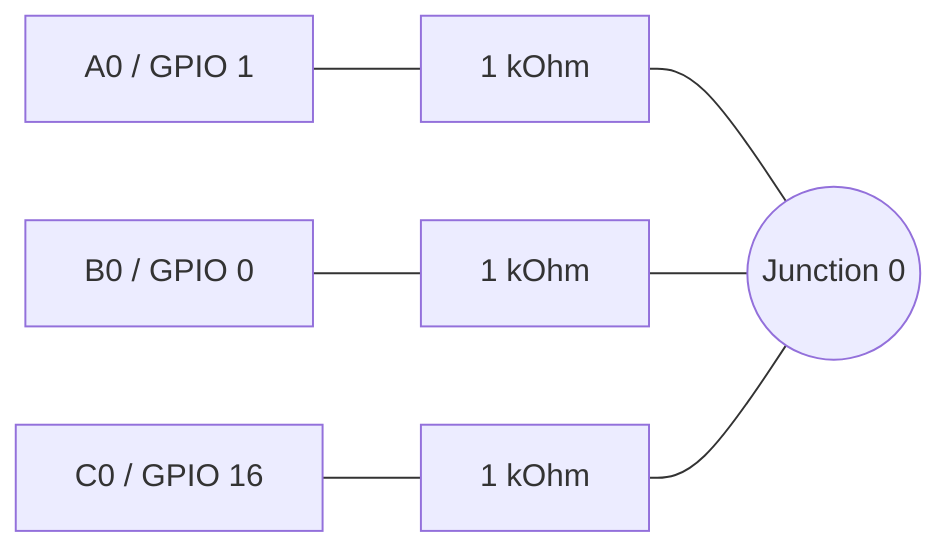

# HIL Test Connections

This guide describes a suggested hardware-in-the-loop (HIL) fixture for PicoPWM on a Raspberry Pi Pico or Pico 2.
It is a wiring plan, not a record of a completed test. Save actual results in [records/](records/README.md).
Use the [HIL test plan](hil-test-plan.md) to select cases and define acceptance limits.

Use the [pinout](../guides/pinout.md) as the source of truth for channel assignments and the
[configuration guide](../guides/configuration.md) for bank roles.

## Equipment

- One Pico or Pico 2 running the firmware under test, with a USB data cable.
- A host computer for the CDC shell or HID dashboard.
- A breadboard, jumper wires and 24 series resistors (1 kOhm each) for the full three-bank fixture.
- An oscilloscope or logic analyzer for independent frequency, duty and stop-state checks.
- Optional 3.3 V-compatible I2C controller for transport tests.

## Safety and Preparation

- Disconnect power before changing wiring. All GPIO signals are **3.3 V only**, not 5 V tolerant.
- Connect instrument and controller grounds to board GND.
- Never connect two outputs together. Set exactly one bank to generator and the other two to monitor, save and reboot
  before enabling a signal. Confirm the running roles, not just the target configuration.
- Start with the SDK default clock and low-frequency signals. Qualify overclock profiles separately.
- Use a series resistor, for example 1 kOhm, in each loopback lead to limit current if roles are misconfigured.
  This is a precaution, not permission to connect outputs together.
- Use GPIO labels below, not physical header pin numbers.

## USB and I2C

Connect the board USB port to the host for power and CDC/HID control.

For optional I2C tests:

| Controller signal | PicoPWM connection |
| --- | --- |
| SDA | GPIO 26 (I2C1 SDA) |
| SCL | GPIO 27 (I2C1 SCL) |
| GND | GND |

Pull SDA and SCL up to **3.3 V**, typically with 4.7 kOhm resistors; account for any pull-ups already fitted to the
controller. Do not connect a controller's power output to the USB-powered board unless the power arrangement is
explicitly designed for it. Start at 100 kHz and use the running slave address (default `0x40`).
See the [I2C protocol](../guides/control/i2c_protocol.md).

## PWM Loopback

For routine functional tests, connect corresponding backend-local channels from all three banks to one shared
junction through a resistor on each GPIO branch. Make **eight separate junctions**; never join the junctions together.

Start with local channel 0:



Lines represent electrical connections, not signal direction. Junction 0 is one connected breadboard row.

Put the three junction-side resistor leads in the same connected breadboard row. Keep the GPIO-side leads separate,
and do not use a power rail as a junction. Repeat for the other seven rows below, using three resistors per junction.

| Local channel | Bank A: hardware | Bank B: PIO | Bank C: software |
| --- | --- | --- | --- |
| 0 | Channel 0, GPIO 1 | Channel 8, GPIO 0 | Channel 16, GPIO 16 |
| 1 | Channel 1, GPIO 3 | Channel 9, GPIO 2 | Channel 17, GPIO 17 |
| 2 | Channel 2, GPIO 5 | Channel 10, GPIO 4 | Channel 18, GPIO 18 |
| 3 | Channel 3, GPIO 7 | Channel 11, GPIO 6 | Channel 19, GPIO 19 |
| 4 | Channel 4, GPIO 9 | Channel 12, GPIO 8 | Channel 20, GPIO 20 |
| 5 | Channel 5, GPIO 11 | Channel 13, GPIO 10 | Channel 21, GPIO 21 |
| 6 | Channel 6, GPIO 13 | Channel 14, GPIO 12 | Channel 22, GPIO 22 |
| 7 | Channel 7, GPIO 15 | Channel 15, GPIO 14 | Channel 23, GPIO 28 |

### Initial Setup

With the loopback disconnected, connect USB and configure the first pass through CDC:

```text
config set a gen
config set b mon
config set c mon
config save
reboot
config
```

Confirm the running roles, disconnect power, attach the loopback and reconnect USB. Start channel 0:

```text
set 0 1000 50
get 8
get 16
```

Allow the monitor windows to settle. Probe junction 0 with an independent instrument referenced to board GND.
Before changing the generator bank, stop output and disconnect the loopback; configure, save and reboot, then
verify the running roles before powering down and reconnecting it.

### Three-Bank Passes

| Pass | Generator | Monitors |
| --- | --- | --- |
| 1 | A (hardware) | B (PIO), C (software) |
| 2 | B (PIO) | A (hardware), C (software) |
| 3 | C (software) | A (hardware), B (PIO) |

Choose frequencies within the supported ranges of **all three** backends for simultaneous monitor comparisons. Begin with a single channel, then
extend to all eight. A loopback reading alone is not an independent accuracy measurement: probe the generator with
an oscilloscope or logic analyzer as well.

For range-boundary, high-frequency or accuracy qualification, use pairwise wiring or an independent instrument/signal
source instead. Disconnect the unused GPIO branch, keep leads short and record the actual wiring and resistor values;
resistors and added input/wiring capacitance can affect fast edges. Pairwise passes are A-to-B, B-to-A, B-to-C,
C-to-B, A-to-C and C-to-A, always with only the source bank configured as generator.

Check ordinary duty cycles, static low/high behavior, and `stop`. Verify a low output after `stop` with the
instrument; monitor readings can take a measurement window to settle. Disconnect or drive inputs to a known level
for no-signal checks rather than relying on floating inputs.

## Record the Test

For each run, record:

- Date, board model, firmware version, commit and artifact SHA-256.
- Host OS, application/version and control interface.
- Running bank roles, system clock and I2C address.
- Wiring/pass used, instrument model, sample rate and measurement settings.
- Requested and realized frequency/duty, independently measured results and acceptance limits.
- Pass/fail results, skipped checks, logs and capture filenames.

Store the report and supporting captures under [records/](records/README.md). A result applies only to the recorded
artifact, wiring and conditions; passing host unit tests does not establish hardware qualification.
